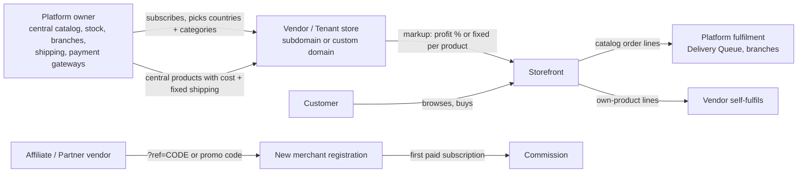
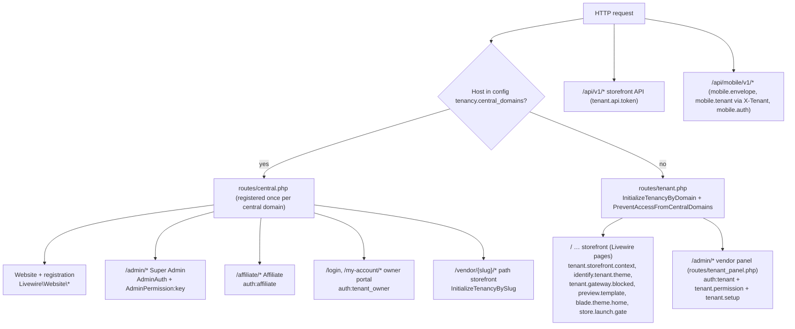
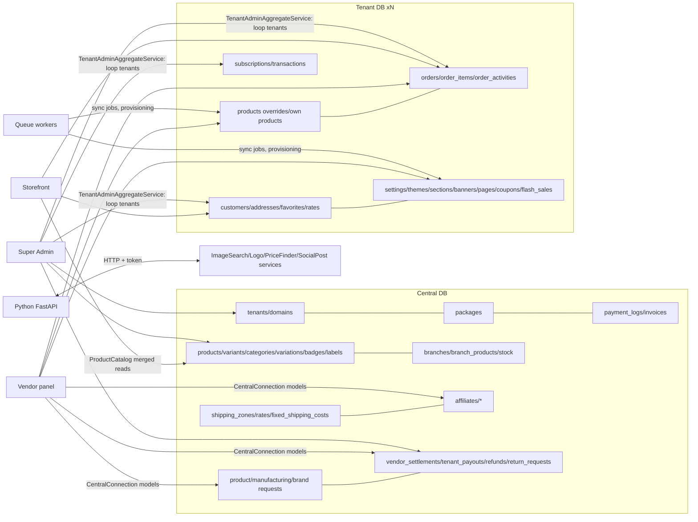
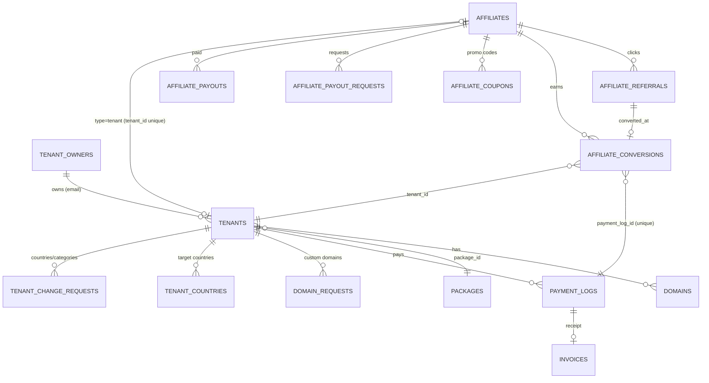
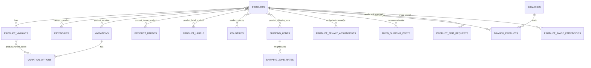
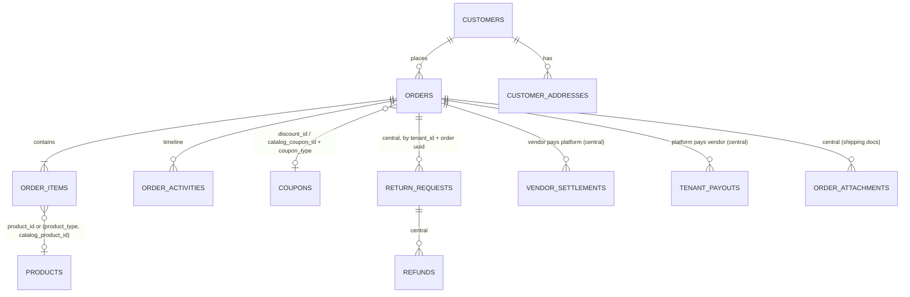
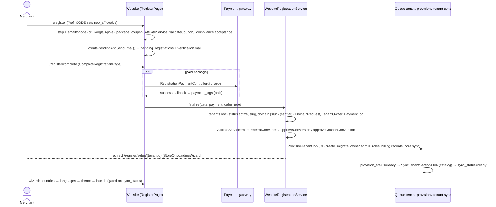

# Complete System Documentation — Multi-Vendor SaaS Commerce Platform

> **Purpose.** This is the master blueprint for rebuilding the platform found in this repository (`/var/www/multi-vendor`, branch `refactor/tenant-central-dedup-plan`, inspected 2026-11-24). It documents what exists, how it works, what is broken or unfinished, and how to rebuild it with the same business model, dashboards, storefront experience and visual identity on a cleaner architecture.
>
> **Method.** Read-only investigation: source files, `php artisan route:list --json` (1,272 registered routes, 838 unique), reflection of 138 Eloquent models and 467 Livewire, controller and FormRequest classes, the live **central** MySQL schema read through `information_schema`, and the **tenant** schema parsed from `database/migrations/tenant`. No application code, configuration or data was changed.
>
> **Evidence levels used in this document**
> - **[Verified]**: read in source, or produced by a command against the code or database.
> - **[Inferred]**: a reasoned conclusion from the code that was not executed end to end.
> - **[Recommendation]**: a proposal for the rebuild.
> - **[Unverified]**: could not be confirmed; listed in §25.3 for manual checking.

---

## Table of contents

| # | Chapter | Where |
|---|---|---|
| 1 | [Executive Summary](#1-executive-summary) | this file |
| 2 | [Project Overview](#2-project-overview) | this file |
| 3 | [Existing Technology Stack](#3-existing-technology-stack) | this file |
| 4 | [Overall System Architecture](#4-overall-system-architecture) | this file |
| 5 | [Multi-Tenancy Architecture](#5-multi-tenancy-architecture) | this file |
| 6 | [Super Admin Dashboard](#6-super-admin-dashboard) | summary here, full detail in [docs/system/dashboard-admin.md](docs/system/dashboard-admin.md) |
| 7 | [Tenant Admin Dashboard](#7-tenant-admin-dashboard) | summary here, full detail in [docs/system/dashboard-tenant.md](docs/system/dashboard-tenant.md) |
| 8 | [Affiliate Dashboard](#8-affiliate-dashboard) | summary here, full detail in [docs/system/dashboard-affiliate.md](docs/system/dashboard-affiliate.md) |
| 9 | [Public Storefront](#9-public-storefront) | summary here, full detail in [docs/system/storefront.md](docs/system/storefront.md) |
| 10 | [Complete Storefront Page Catalog](#10-complete-storefront-page-catalog) | [docs/system/storefront.md](docs/system/storefront.md) |
| 11 | [UI/UX and Design System](#11-uiux-and-design-system) | [docs/system/ui-ux-design-system.md](docs/system/ui-ux-design-system.md) |
| 12 | [Database Architecture and ER Diagrams](#12-database-architecture-and-er-diagrams) | this file + generated [docs/system/database-schema.md](docs/system/database-schema.md) |
| 13 | [Business Logic and Workflows](#13-business-logic-and-workflows) | this file |
| 14 | [Routes and APIs Inventory](#14-routes-and-apis-inventory) | generated [docs/system/routes-inventory.md](docs/system/routes-inventory.md) and [docs/system/module-inventory.md](docs/system/module-inventory.md) |
| 15 | [Authentication, Roles, and Permissions](#15-authentication-roles-and-permissions) | this file |
| 16 | [Integrations and External Services](#16-integrations-and-external-services) | this file |
| 17 | [Notifications and Background Jobs](#17-notifications-and-background-jobs) | this file |
| 18 | [Security and Tenant Isolation](#18-security-and-tenant-isolation) | this file |
| 19 | [Current Problems and Technical Debt](#19-current-problems-and-technical-debt) | this file |
| 20 | [Recommended New Architecture](#20-recommended-new-architecture) | [docs/system/rebuild-blueprint.md](docs/system/rebuild-blueprint.md) |
| 21 | [New Project Technology Stack](#21-new-project-technology-stack) | [docs/system/rebuild-blueprint.md](docs/system/rebuild-blueprint.md) |
| 22 | [Proposed Database and Folder Structure](#22-proposed-database-and-folder-structure) | [docs/system/rebuild-blueprint.md](docs/system/rebuild-blueprint.md) |
| 23 | [New Project Implementation Roadmap](#23-new-project-implementation-roadmap) | [docs/system/rebuild-blueprint.md](docs/system/rebuild-blueprint.md) |
| 24 | [Complete Feature Parity Checklist](#24-complete-feature-parity-checklist) | [docs/system/rebuild-blueprint.md](docs/system/rebuild-blueprint.md) |
| 25 | [Glossary, References and Investigation Summary](#25-glossary-technical-references-and-investigation-summary) | this file |

**Supporting documents (all under `docs/system/`)**

| File | Content | How produced |
|---|---|---|
| [dashboard-admin.md](docs/system/dashboard-admin.md) | Super Admin panel: every sidebar item and every module | hand-written from source |
| [dashboard-tenant.md](docs/system/dashboard-tenant.md) | Vendor (tenant) panel: every module, plus isolation | hand-written from source |
| [dashboard-affiliate.md](docs/system/dashboard-affiliate.md) | Affiliate panel, the full lifecycle, and the vendor Partner Program | hand-written from source |
| [storefront.md](docs/system/storefront.md) | Storefront routing, themes, and every page | hand-written from source |
| [ui-ux-design-system.md](docs/system/ui-ux-design-system.md) | Tokens, components, and the four interface styles | hand-written from CSS and Blade |
| [rebuild-blueprint.md](docs/system/rebuild-blueprint.md) | Target architecture, stack, schema, folders, roadmap, parity checklist | recommendations |
| [routes-inventory.md](docs/system/routes-inventory.md) | All 838 unique routes: method, URI, name, action, middleware | **generated** from `route:list --json` |
| [module-inventory.md](docs/system/module-inventory.md) | Routes joined with handler classes: form fields, actions, validation rules, views | **generated** by reflection |
| [database-schema.md](docs/system/database-schema.md) | Every central table (live) and every tenant table (from migrations): columns, foreign keys, indexes, models, relations | **generated** |
| [generators/](docs/system/generators/README.md) | Read-only scripts that regenerate the three generated references | scripts |

> The repository's existing `docs/*.md` files remain authoritative for their own topics, and this documentation links to them: `docs/ORDER_FORMULAS.md` (all money formulas), `docs/AFFILIATE_SYSTEM.md`, `docs/TENANT_CENTRAL_DEDUP_PLAN.md`, `docs/tenant-panel-refactor.md`, `docs/blade-theme-variants-lifecycle.md`, `docs/REGISTRATION_PROVISIONING_PLAN.md`, `docs/notifications.md`, and the deployment guides `docs/01…09`.

---

## 1. Executive Summary

**What the system is [Verified].** A multi-tenant SaaS e-commerce platform in which the platform owner runs a **central product catalog with central stock, warehouses ("branches"), shipping and fulfilment**. Merchants ("vendors" or "tenants") subscribe to a plan, get their own store on a subdomain or custom domain, choose target countries and categories, and **resell central catalog products at their own markup**. Merchants can also sell their **own products**, which they fulfil themselves. Customers buy on the merchant's storefront. The platform fulfils catalog orders, and money is split between platform and vendor using exact formulas (`docs/ORDER_FORMULAS.md`). An **affiliate program** pays commission to partners, both external affiliates and vendors, who refer new merchants that buy a paid subscription.

**Main parts**

| Area | Users | Tech (today) | Size |
|---|---|---|---|
| Central marketing site + registration + onboarding wizard | prospective merchants | Livewire 4 | 35 routes |
| **Super Admin panel** `/admin` on the central domain | platform staff | Livewire 4 (122 of 172 routes) | 172 routes, 24 top-level sidebar entries → 80 pages in 4 sections |
| **Tenant (vendor) panel** `/admin` on the store domain | merchant staff | Blade + controllers + vanilla JS (423 of 424 routes) | 424 routes |
| **Affiliate panel** `/affiliate` on the central domain | affiliates | Livewire 4 | 10 routes |
| Tenant-owner portal `/my-account` | merchant owners with several stores | Livewire | (in the central routes) |
| **Storefront** on the tenant domain, plus a path-based mirror `/vendor/{slug}` | shoppers | Livewire full-page components rendered through 3 built-in themes or an uploaded vendor Blade theme | 53 + 32 routes |
| Storefront REST API `/api/v1` and Mobile API `/api/mobile/v1` | mobile apps, headless clients | JSON controllers | 32 + 63 routes |
| Python FastAPI sidecar (`python-modules/`) | internal | FastAPI + OpenAI | image search, logo generator, price finder, social posts |

**Most important findings**

1. **Hybrid multi-tenancy (stancl/tenancy v3): database per tenant, central database for shared data [Verified].** Domain, subdomain and slug-path identification all exist. Many tenant-context models deliberately use `CentralConnection`, so tenant requests read central tables directly.
2. **A catalog de-duplication refactor is half-finished [Verified].** Tenants historically held *synced copies* of central products, categories, coupons and so on (`TenantCatalogSyncService`, about 13 sync sections). The current branch adds a per-tenant, per-section `catalog_source` flag (`sync` | `central`) and "merged" read models (`app/Models/Tenant/Catalog/Merged*`, `app/Repositories/Tenant/Catalog/*`). Both code paths coexist. The rebuild should implement only the target model: central live reads plus tenant override tables.
3. **Cross-tenant admin reporting does not scale [Verified].** `App\Services\Admin\TenantAdminAggregateService::collectAcrossTenants()` initializes tenancy for **every tenant**, loads all orders, customers and transactions into memory, then filters and paginates in PHP (`OrderRepository::paginate()`). This is the main scalability blocker.
4. **Security hotspots [Verified]:** vendor-uploaded **Blade themes are compiled and executed server-side**, protected only by a string denylist plus admin approval (`BladeThemeService::BLOCKED_PATTERNS`; the code comments admit the denylist is not sufficient). 53 authenticated vendor-panel business routes (manufacturing 13, brand requests 11, support 9, purchase/payment charge and callback endpoints 18, compliance 2) have **no `tenant.permission` middleware**. `/admin/products-run` triggers a job with only `admin.auth`. The `/api/v1` "bearer token" is the public tenant id.
5. **Dead code and documentation drift [Verified].** `docs/tenant-panel-refactor.md` says the tenant Livewire panel classes were deleted, but about 40 unreferenced classes (~5,800 LOC) remain under `app/Livewire/Tenant/*` and elsewhere (§19).
6. **Two queues the jobs need are never consumed [Verified from config].** The documented worker (`docs/configs/laravel-queue.service`) listens on `tenant-provision,tenant-sync,tenant-profit,default,neozena-import`, but 12 dispatches go to `translations` and 1 to `tenant-catalog-sync`.

**Recommended direction [Recommendation].** Keep Laravel and keep database-per-tenant isolation, but build a **modular monolith** with explicit bounded contexts (Platform, Catalog, Commerce/Orders, Fulfilment, Billing, Affiliates, Storefront, Content). Add a **central reporting read-model** (an event-fed `order_facts` table) instead of fan-out queries, a single catalog model (central truth + tenant overrides), sandboxed storefront theming (token/section JSON or a safe template engine, never raw Blade from vendors), and one UI stack per surface. Full plan: [docs/system/rebuild-blueprint.md](docs/system/rebuild-blueprint.md).

---

## 2. Project Overview

### 2.1 Business model [Verified]



- **Revenue streams [Verified]:**
  1. Subscription packages (`packages`; terms `monthly|quarterly|yearly|lifetime`, with trial days and limits).
  2. The platform's share of each catalog order: cost, fixed shipping, shipping charge, tax and central discounts (`orders.platform_profit`).
  3. Paid add-ons: paid languages (`tenant_language_purchases`), AI translation (`tenant_ai_translation_purchases`), manufacturing and brand requests with payment requests (`manufacturing_payment_requests`, `brand_payment_requests`).
- **Who collects the money [Verified]:** `orders.collected_by` = `vendor` (tenant gateway or cash on delivery) or `platform` (central gateway).
  - When the vendor collects, the vendor owes the platform its share and pays it via **Settlement Payments** (`vendor_settlements`).
  - When the platform collects, it owes the vendor its share, paid through **Tenant Payouts** (`tenant_payouts`, `orders.payout_released`).

### 2.2 Actors and guards [Verified, `config/auth.php`]

| Actor | Guard | Model / DB | Logs in at |
|---|---|---|---|
| Platform staff | `admin` | `App\Models\AdminUser` → central `admins` | `{central}/admin/login` |
| Vendor staff | `tenant` | `App\Models\Tenant\AdminUser` → tenant `admins` | `{store-domain}/admin/login` |
| Store owner (multi-store) | `tenant_owner` | `App\Models\TenantOwner` → central `tenant_owners` | `{central}/login`, `/my-account/*` |
| Affiliate | `affiliate` | `App\Models\Affiliate` → central `affiliates` | `{central}/affiliate/login` |
| Shopper | `storefront` | `App\Models\Tenant\Customer` → tenant `customers` | `{store}/account/login`; mobile apps use bearer tokens (`mobile_access_tokens`) |

### 2.3 Repository layout [Verified]

```
app/
  Console/Commands/      28 artisan commands (catalog dedup, e2e, neozena import, pool, images…)
  Enums/                 50+ enums (statuses, types)
  Events/ Observers/ Jobs/ Mail/ Notifications/
  Helpers/               AdminNavigation, TenantNavigation, functions.php (global helpers)
  Http/Controllers/{Admin,Affiliate,Mobile,Tenant,Tenant/Panel/*,Website}
  Http/Middleware/       ~40 middleware (tenancy, permissions, storefront context, gates)
  Http/Requests/         FormRequests (mostly tenant panel)
  Livewire/{Admin,Affiliate,Tenant,TenantOwner,Website}
  Models/ (central) + Models/Tenant/ (tenant DB) + Models/Tenant/Catalog/ (merged read models)
  PaymentGateway/        29 gateway drivers (strategy pattern) + PaymentManager
  Repositories/ Services/ Support/  business logic (OrderPricing, OrderProfitCalculator, …)
database/migrations/            187 central migrations
database/migrations/tenant/     132 tenant migrations (+ tenant_dedup_drops/)
resources/views/{admin,auth,components,emails,errors,layouts,livewire,payments,storefront,tenant,themes}
resources/css/  app.css (central/admin), website.css, tenant/** (vendor design system), theme CSS (elora*, souqify*, ecommet)
resources/js/   app.js (central), tenant/** (vendor panel), storefront & theme JS
routes/         web.php → central.php (per central domain); tenant.php → tenant_panel.php; tenant_path.php; api.php; mobile.php; channels.php; console.php
python-modules/ FastAPI service (image_search, logo_generator, price_finder, social_post_generator)
tests/          93 PHPUnit test files + 6 Playwright e2e specs
```

---

## 3. Existing Technology Stack

| Layer | Technology [Verified: `composer.json`, `package.json`] | Notes |
|---|---|---|
| Language / framework | PHP 8.3.37, **Laravel 13.30.1** | `bootstrap/app.php` uses the slim Laravel 11+ structure |
| Multi-tenancy | **stancl/tenancy ^3.10** | DB-per-tenant (`dokan_v2_{tenant_id}`); tenant-suffixed filesystem; scoped cache (custom `SafeCacheTenancyBootstrapper`); queue tenancy |
| Server-rendered UI | **Livewire ^4.2** (central admin, affiliate, owner, website, storefront); **Blade + controllers + vanilla JS** (tenant panel) | memory rule: new UI must not use Livewire |
| Data tables | yajra/laravel-datatables ^13 (server) + DataTables 2.3 (client) | tenant panel |
| Real-time | **laravel/reverb ^1.11**, laravel-echo, pusher-js | notification bell, support, request chats |
| Auth extras | laravel/socialite + Apple provider | Google/Apple sign-in for owners and shoppers |
| Payments | stripe-php, PayPal REST SDK, Mollie, Razorpay, Iyzico, Midtrans, Omnipay/Authorize.Net, plus HTTP drivers for 20+ more | `app/PaymentGateway/Gateways/*` (29 classes) |
| Images | intervention/image ^3.11; AVIF conversion (`images:convert-avif`) | `docs/IMAGE_OPTIMIZER.md` |
| CSS | **Tailwind CSS v4** via `@tailwindcss/vite` (central/admin), plus a **Tailwind v3** build (`resources/tailwind-v3/build.cjs`) and large hand-written theme CSS | two Tailwind majors side by side |
| JS libs | jQuery 3, select2 4.0.13, flatpickr, intl-tel-input, SortableJS, Swiper 12, TinyMCE 7, SweetAlert2, toastr, Chart.js 4 | lazy-loaded per page in the tenant panel |
| Fonts | 25 `@fontsource/*` families (Inter, Outfit, DM Sans, Syne, Cairo, Tajawal, IBM Plex Sans Arabic, …) | Arabic and RTL supported |
| Build | Vite 8, laravel-vite-plugin 3 | ~200 explicit inputs in `vite.config.js` |
| Tests | PHPUnit 12 + paratest; Playwright 1.56 | `tests/Feature`, `tests/Unit`, `tests/e2e` |
| Dev tooling | debugbar, pail, pint; a `TelescopeServiceProvider` file exists but Telescope is **not** installed or registered | |
| Sidecar | Python FastAPI (`python-modules/app.py`) | `PYTHON_MODULES_URL`, `PYTHON_MODULES_TOKEN` |
| Infra (docs) | Ubuntu VPS, Apache2 + PHP-FPM, MySQL 8, systemd queue worker + cron, wildcard SSL | `docs/01…09` |

---

## 4. Overall System Architecture

### 4.1 Request routing [Verified, `bootstrap/app.php`, `routes/web.php`, `TenancyServiceProvider::mapRoutes`]



- Global web middleware: `SetLocale`, `CheckMaintenanceWindow`. `trustHosts` allows every host (`'.*'`). The `tenant_theme` cookie is exempt from encryption.
- CSRF exemptions: `auth/apple/callback`, `checkout/payment/*/webhook`.
- Exception mapping: an unknown tenant domain redirects to `APP_URL?error=This store does not exist.`. On tenant domains, 404 and 500 errors redirect to `tenant.storefront.not-found`. `ReadOnlyCatalogRowException` returns a 422 message.

### 4.2 Component interaction [Verified]



Key architectural rules found in code and docs:
- **All order money goes through `App\Support\OrderPricing`, `OrderProfitCalculator`, `OrderPayoutLedger` and `App\Services\Tenant\Checkout\OrderComposer`** (CLAUDE.md, `docs/ORDER_FORMULAS.md`).
- Tenant-context code that must read central data uses models carrying `Stancl\Tenancy\Database\Concerns\CentralConnection`. For example, all `Affiliate*` models, `ReturnRequest`, `Refund`, `VendorSettlement` and `TenantPayout` use it; full list in [database-schema.md](docs/system/database-schema.md).
- Panel-wide AJAX JSON contract (vendor panel): `{success, message, data?, redirect?}`, with 422 for validation errors and 409 for "setup incomplete" (`docs/tenant-panel-refactor.md` §2).

---

## 5. Multi-Tenancy Architecture

### 5.1 Identification [Verified]

| Mode | Middleware | How | Used by |
|---|---|---|---|
| Domain / subdomain | `Stancl\…\InitializeTenancyByDomain` + `PreventAccessFromCentralDomains` | host → `domains.domain` → `tenants.id` | storefront + vendor panel (`routes/tenant.php`) |
| Slug path | `App\Http\Middleware\InitializeTenancyBySlug` | `/vendor/{tenant}` → `Tenant::whereJsonContains('data->slug', $slug)` (**unindexed JSON lookup on every request**) | path storefront (`routes/tenant_path.php`), Livewire updates at `/s/{slug}/livewire/update` |
| Header | `ResolveMobileTenant` | `X-Tenant: {tenant_id}` (or a route param); must be `TenantStatus::Active` | mobile API |
| Bearer | `IdentifyTenantByApiToken` | `Authorization: Bearer {tenant_id}` | `/api/v1` |
| Preview | `InitializeTenancyForPreview` | `/preview/*` theme previews | central preview routes |

Central domains are configured in `config/tenancy.php` → `central_domains` (`dokan-v2.loc`, `127.0.0.1`, `localhost` locally). `routes/web.php` registers `central.php` once per central domain, which is why route:list shows each central route three times.

### 5.2 Data isolation [Verified]

- **Database:** `DatabaseTenancyBootstrapper` switches the default connection to `dokan_v2_{tenant_id}`. A DB **pool** pre-creates databases (`tenant_database_pool` table, `TenantDatabasePool`, `RefillTenantDatabasePoolJob`, `tenants:pool-fill`, `TENANCY_DATABASE_POOL_SIZE` default 5).
- **Filesystem:** `SafeFilesystemTenancyBootstrapper` suffixes `storage_path()` and the `local`/`public` disks with `tenant{id}`.
- **Cache:** `SafeCacheTenancyBootstrapper` (tagged cache scoped by tenant).
- **Queue:** `QueueTenancyBootstrapper` serializes the tenant id into jobs.
- **Central data that is shared with tenant scope:** central tables keyed by `tenant_id` (`product_tenant_assignments`, `return_requests`, `refunds`, `vendor_settlements`, `tenant_payouts`, `support_tickets`, `domain_requests`, `affiliates.tenant_id`, …) rely on **application-level `where('tenant_id', tenant('id'))` filters**. There is no DB-level enforcement. The dedup plan itself flags this as a new risk (`docs/TENANT_CENTRAL_DEDUP_PLAN.md` §0.2 item 3).
- **Broadcast channels:** `tenant.{tenantId}.*` authorize with `tenant('id') === $tenantId` under the `tenant` guard (`routes/channels.php`).

### 5.3 Tenant lifecycle [Verified]

```mermaid
stateDiagram-v2
    [*] --> PendingRegistration: RegisterPage (email verify, package, payment)
    PendingRegistration --> Active: CompleteRegistrationPage → WebsiteRegistrationService::finalize()
    Active: TenantStatus = onboarding / active
    Active --> Provisioning: ProvisionTenantJob (queue tenant-provision)<br/>DB, migrate, owner admin, roles, billing, core sync
    Provisioning --> Wizard: provision_status=ready → StoreOnboardingWizard (countries → languages → theme → launch)
    Wizard --> Launched: launch_ready=true, or all setup steps done (StoreLaunchGate)
    Launched --> Suspended: admin (TenantStatus::Suspended)
    Suspended --> Launched
    Launched --> Archived
```

- `tenants.data` JSON (stancl VirtualColumn) holds `slug`, `provision_status`, `sync_status`, `catalog_source`, `category_ids`, `launch_ready` and more. Typed casts live in `App\Models\Tenant` (`trial_ends_at`, `activated_at`, `compliance_accepted_at`, `launch_ready`, …).
- Store-not-launched visitors get `errors.store-not-launched` (`StoreLaunchGate`; note it hardcodes `http://` for the admin link).
- The vendor panel forces setup steps through `SetupGuard` (`tenant.setup:{step}`; mandatory steps return 409 JSON or redirect to `tenant.onboarding`).

### 5.4 Catalog sharing model: current transition [Verified]

| Mode (`tenants.data.catalog_source[section]`) | Read path | Write path |
|---|---|---|
| `sync` (default) | tenant tables holding **copies** of central rows (`products.central_product_id`, `categories`, `coupons`, …) | central observers (`CentralCatalogSyncObserver`, `CentralSharedTenantSyncObserver`, …) dispatch `SyncCentralProductToTenantJob`, `SyncCentralProductPriceToTenantsJob`, … on queue `tenant-sync` |
| `central` | merged read models: `ProductCatalog::productsSql()` = central rows + `tenant_product_overrides` / `tenant_field_overrides` + own rows; typed refs `catalog_product_id` / `product_type` on order lines | tenant writes go only to override tables; `CentralWriteGuard` and `ReadOnlyCatalogRowException` block edits to platform-owned fields |

Sections: `languages, currencies, settings, payment-gateways, themes, email-templates, pages, categories, products, badges, labels, flash-sales, coupons` (`App\Support\CatalogSource::SECTIONS`). Per the project memory note dated 2026-11-24, sync is being **removed** in favour of central live reads plus tenant overrides. Code for both modes is still present.

---

## 6. Super Admin Dashboard

**Full module-by-module documentation: [docs/system/dashboard-admin.md](docs/system/dashboard-admin.md).**

- URL `{central-domain}/admin`; login `admin.login` (Livewire `Admin\Auth\LoginPage`); guard `admin`; middleware `AdminAuth` + `AdminPermission:{key}` per route.
- Layout: `resources/views/layouts/admin*.blade.php` with a sidebar from `App\Helpers\AdminNavigation::sections()`. Items are filtered by permission (`visibleSections()`); the breadcrumb comes from `routeInfo()`. There is a dark/light theme toggle (`[data-theme]`) and a real-time notification bell (Reverb).
- Sidebar: 4 sections, 24 top-level entries, 80 leaf pages. **All 80 route references in the navigation resolve to registered routes [Verified].**

| Section | Entries |
|---|---|
| Overview | Dashboard |
| Commerce | Product Management (Products, Categories, Variations, Labels, 5 badge lists, Edit Requests, Product Requests); Orders (List, Report, Returns, Refunds, Return Analytics); Shipping (In Delivery, Fixed Shipping Costs, Delivery Charges/Zones, Branches, Settings, Default Shipping Days, Delivery Popup Days); Store (Coupons, Flash Sales, Tenant Sync); Manufacturing; Brand Requests; Payment Logs; Customers; Notifications; Support; Plans (Registered Users = tenants, Pending Registrations, Tenant Change Requests, Plans); Compliance; Wallet Management (Tenants Ledger, Finance Reports, Vendor Settlements, Tenant Payouts, Transactions, Invoices); Affiliates (Accounts, Conversions, Payouts, Reports, Promo Codes) |
| Content | Blog (Categories, Posts); Domains (Requests, DNS Records); Static Pages; FAQs; Newsletter |
| System | Settings (19 pages: General, Home Variants, Template Control, Blade Theme Queue, Payment Gateways, Gateway Limits, Email Templates, Email Configuration, Social Login, AI, Currencies, Languages, Translation Key Access, Language Purchases, Translation Files, Countries, Maintenance, Return Policy, Default Banners); Admins (Users, Roles & Permissions); Clear Cache (Tenants, Main); Developer Docs |

---

## 7. Tenant Admin Dashboard

**Full module-by-module documentation: [docs/system/dashboard-tenant.md](docs/system/dashboard-tenant.md).**

- URL `{store-domain}/admin`; guard `tenant`; middleware `auth:tenant`, `EnsureTenantTourSeen`, `SetTenantPanelLocale`, `tenant.permission:{key}`, `tenant.setup:{step}`.
- Stack: controllers in `app/Http/Controllers/Tenant/Panel/{Section}`, FormRequests in `app/Http/Requests/Tenant/Panel`, views in `resources/views/tenant/pages/**`, components `x-tenant::*`, and JS `resources/js/tenant/**` (`docs/tenant-panel-refactor.md`).
- Sidebar (`App\Helpers\TenantNavigation`): Dashboard, Products (central catalog, own products, categories, badges), Orders (All, Returns, Refunds, Return Analytics), Customers, Your Store (Themes, Page Builder, Pages, Appearance, Banners, Blade Theme), Ads & Marketing (Coupons, Flash Sales), Analytics, Request Product (Product, Manufacturing and Brand Requests), Partner Program, Settings (15 pages), Finance (Subscriptions & Balance, Billing, Vendor Purchases, Settlement Payments, Payouts Received), Get Started, Notifications, Support, Documentation, Website URL. Mobile App and App Themes entries are commented out.
- 32 tenant permissions (`App\Models\Tenant\AdminRole::availablePermissions()`); default roles `Store Owner`, `Manager` and `Support` (`defaultRoleDefinitions()`).

---

## 8. Affiliate Dashboard

**Full documentation: [docs/system/dashboard-affiliate.md](docs/system/dashboard-affiliate.md).**

- `{central}/affiliate/{login,register,dashboard,links,conversions,payouts,profile}` (Livewire `App\Livewire\Affiliate\*`); guard `affiliate`; SSO from the vendor panel at `/affiliate/sso/{token}`.
- Commission is earned **only on a referred merchant's first paid subscription payment**, not on shopper orders. Tracking uses `?ref=CODE` on any central website page (`track.affiliate`), sets cookie `neo_aff` (default 90 days, first referrer wins), and writes one `affiliate_referrals` row per tracked click. Conversions go `pending → approved → paid`, or `rejected` / `refunded`. Promo codes (`affiliate_coupons`) are an alternative attribution path. Payout requests are approved and paid manually by the admin.
- Vendors are also affiliates (`affiliates.type = tenant`, non-login rows) through the vendor **Partner Program** page.

---

## 9. Public Storefront

**Full documentation: [docs/system/storefront.md](docs/system/storefront.md).**

- Served on the tenant subdomain or custom domain (`routes/tenant.php`), mirrored at `{central}/vendor/{slug}/…` (`routes/tenant_path.php`). The vendor admin is **not** exposed on the path variant.
- Pages are Livewire full-page components (`App\Livewire\Tenant\Storefront\*`) that render through a **TemplateStrategy** (`App\Contracts\TemplateStrategy`):
  - built-in themes `ecommet`, `elora` (home variants v1–v6) and `souqify` (v1–v6) in `resources/views/themes/{slug}`;
  - or an admin-approved **vendor-uploaded Blade theme** (`UploadedBladeTemplateStrategy`, live views in `storage/app/tenants/{id}/theme/views`, prepended by `IdentifyTenantTheme`).
- Home page sections are configurable per theme (`App\Services\Tenant\PageBuilder\SectionRegistry`, `tenant_page_sections`, `home_variants`).
- Context per visitor: country (Cloudflare `CF-IPCountry` via `CountryDetectorService`, `?country=XX` override), currency, language, **country-based product visibility** (`products.allowed_country_ids`), and session cart `storefront_cart`.

---

## 10. Complete Storefront Page Catalog

Documented page by page in [docs/system/storefront.md §4](docs/system/storefront.md#4-page-catalog). Summary of the **25 customer-facing page types** discovered [Verified]:

| # | Page | URL (domain mode) | Route name | Auth |
|---|---|---|---|---|
| 1 | Home | `/` | `tenant.home` | public |
| 2 | Best selling / Search results | `/best-selling`, `/search?q=` | `tenant.storefront.best-selling`, `.search` | public |
| 3 | Full-star (top rated) | `/full-star` | `tenant.storefront.full-star` | public |
| 4 | New in | `/new-in` | `tenant.storefront.new-in` | public |
| 5 | Offers | `/offers` | `tenant.storefront.offers` | public |
| 6 | Category / all categories | `/categories/{slug?}` | `tenant.storefront.category` | public |
| 7 | Product details | `/products/{slug}` | `tenant.storefront.product` | public |
| 8 | Cart | `/cart` | `tenant.storefront.cart` | public (session) |
| 9 | Checkout | `/checkout` | `tenant.storefront.checkout` | login enforced in `mount()` (domain) / `auth:storefront` (path) |
| 10 | Payment charge / success / cancel | `/checkout/payment/{gateway}/…` | `tenant.payment.*` | `auth:storefront` |
| 11 | Order status (thank you) | `/orders/{uuid}/status` | `tenant.storefront.order-status` | public (UUID-guarded) |
| 12 | Order tracking | `/orders/{uuid}/tracking` | `tenant.storefront.order-tracking` | public (UUID-guarded) |
| 13 | Request return | `/orders/{uuid}/return` | `tenant.storefront.order-return` | customer |
| 14 | Return detail | `/account/returns/{id}` | `tenant.storefront.return-detail` | customer |
| 15 | Invoice (printable) | `/orders/{uuid}/invoice` | `tenant.storefront.order-invoice` | customer |
| 16 | Login / Register (one page) + Google/Apple | `/account/login` | `tenant.storefront.login` | guest |
| 17 | Account (tabs: orders, profile, wishlist, returns) | `/profile` | `tenant.storefront.profile` | customer |
| 18 | Favorites (wishlist) | `/favorites` | `tenant.storefront.favorites` | customer |
| 19 | CMS page (about, contact, privacy, terms, shipping, returns, FAQ… as vendor pages) | `/pages/{slug}` | `tenant.storefront.page` | public |
| 20 | 404 | `/not-found` + fallback | `tenant.storefront.not-found` / `.404` | public |
| 21 | Store not launched | any (gate) | view `errors.store-not-launched` | public |
| 22 | Maintenance | any (`CheckMaintenanceWindow`) | `MaintenancePageContext` | public |
| 23 | Mobile app landing | `/app` | `tenant.app-landing` | public |
| 24 | robots.txt / sitemap.xml | `/robots.txt`, `/sitemap.xml` | `tenant.robots`, `tenant.sitemap` | public |
| 25 | Support request form | Livewire `SupportRequestForm` (embedded) | — | public |

**Not present [Verified]:** compare products, blog (only the central marketing site has a blog), separate about, contact and FAQ routes (handled as vendor CMS pages), a newsletter form on the storefront (a `subscribers` table and a vendor "Subscribers" page exist, but that nav item is commented out), separate addresses and order-detail pages (both live inside `/profile`).

---

## 11. UI/UX and Design System

**Full documentation: [docs/system/ui-ux-design-system.md](docs/system/ui-ux-design-system.md).**

The four interfaces have different design languages:

| Interface | Tokens / CSS | Fonts | Primary color | Character |
|---|---|---|---|---|
| Super Admin, Affiliate, Owner | `resources/css/app.css` (Tailwind v4 + `[data-theme]` variables) | DM Sans (body), Syne (display) | cyan `#00e5ff` / violet `#a259ff` (dark); `#0097c4` / `#7c3aed` (light) | dark-first "neon" dashboard |
| Vendor panel | `resources/css/tenant/base/tokens.css` (`--ds-*`, scoped to `.t-scope`) + `resources/css/tenant/components/*.css` | Outfit; IBM Plex Sans Arabic for RTL | brand orange `#FD6F04`; gradient `#612CFF → #FF8A65` | light-first, square buttons (`--ds-radius-btn: 0`), 12px cards |
| Marketing site | `resources/css/website.css` | — | `#FF4B2B` | landing pages |
| Storefront themes | `elora*.css`, `souqify*.css`, `ecommet.css`; tenant colors from `tenant_theme_colors`; `ThemeTokenCatalog` / `ThemeFonts` | per theme / vendor choice | Elora and Souqify `#FF4D00`; Ecommet purple `#61167f` + sale reds | consumer e-commerce, Swiper carousels |

---

## 12. Database Architecture and ER Diagrams

**Complete column-level reference: [docs/system/database-schema.md](docs/system/database-schema.md)** (104 central tables read live; 63 tenant tables parsed from migrations, plus 3 loop-created pivot tables).

### 12.1 Where data lives [Verified]

| Domain | Central DB | Tenant DB |
|---|---|---|
| Platform & tenancy | `tenants`, `domains`, `tenant_database_pool`, `tenant_owners`, `pending_registrations`, `tenant_countries`, `tenant_change_requests`, `tenant_mobile_apps`, `domain_requests`, `dns_records`, `maintenance_windows`, `app_settings` | `settings`, `maintenance_windows` |
| Plans & billing | `packages`, `payment_logs`, `invoices`, `payment_gateways` (platform), `tenant_language_purchases`, `tenant_ai_translation_purchases` | `subscriptions`, `transactions`, `payment_gateways` (vendor's own, credentials `encrypted:array`), `language_purchases` |
| Catalog | `products`, `product_variants`, `variations`, `variation_options`, `product_variation`, `product_variant_option`, `categories`, `category_product`, `product_badges`, `product_badge_product`, `product_labels`, `product_label_product`, `product_country`, `product_shipping_zone`, `product_tenant_assignments`, `product_image_embeddings`, `product_edit_requests` | `products` (copies/overrides + own products), `product_variants`, `categories`, `category_product`, `product_badges`, `product_labels`, `tenant_product_overrides`, `tenant_product_variant_overrides`, `tenant_category_overrides`, `tenant_category_product_overrides`, `tenant_badge_product_overrides`, `tenant_field_overrides`, `translations`, `translation_overrides` |
| Stock & logistics | `branches`, `branch_products`, `shipping_zones`, `shipping_zone_rates`, `fixed_shipping_costs`, `shipping_day_rules`, `shipping_stops`, `delivery_popup_days`, `countries`, `cities` | — |
| Orders | `order_attachments`, `return_requests`, `return_request_media`, `return_request_notes`, `refunds`, `vendor_settlements`, `tenant_payouts` | `orders`, `order_items`, `order_activities` |
| Customers | (aggregated only) | `customers`, `customer_addresses`, `favorites`, `product_rates`, `subscribers`, `mobile_*` |
| Marketing | `central_coupons` (+ `central_coupon_country`), `central_flash_sales` (+ `_country`, `_product`), `default_banners` | `coupons`, `flash_sales`, `flash_sale_product`, `banners`, `*_country` pivots |
| Storefront config | `templates`, `template_parts`, `template_country`, `home_variants`, `blade_themes` | `themes`, `theme_country`, `tenant_home_variants`, `tenant_page_sections`, `tenant_theme_colors`, `pages`, `social_links`, `mobile_app_settings`, `mobile_app_theme` |
| Requests & support | `product_requests` (+ messages), `manufacturing_requests` (+ messages, payment requests), `brand_requests` (+ messages, payment requests), `support_tickets` (+ messages) | `tenant_notifications` |
| Affiliates | `affiliates`, `affiliate_referrals`, `affiliate_conversions`, `affiliate_coupons`, `affiliate_payouts`, `affiliate_payout_requests`, `affiliate_login_tokens` | — |
| Content | `blog_categories`, `blog_posts`, `static_pages`, `faqs`, `newsletter_subscribers`, `email_templates` (+ translations), `languages`, `translations`, `currencies`, `files` | `email_templates` (+ translations), `languages`, `currencies`, `files` |
| Infra | `jobs`, `job_batches`, `failed_jobs`, `cache`, `cache_locks`, `sessions`, `catalog_dedup_runs`, `catalog_ai_batch_jobs` | `jobs`, `failed_jobs`, `cache`, `sessions` |

**Schema smell [Verified]:** the central schema **also contains tenant-like tables** (`admin_roles`, `admins`, `email_templates`, `languages`, `files`, `translations`, `currencies`, …). These are central-admin equivalents with the same names as tenant tables, and the identical names are one source of the sync/dedup complexity.

### 12.2 Core ER diagram: platform, tenancy, billing, affiliates



### 12.3 Catalog and stock (central)



### 12.4 Orders (tenant DB) and settlement (central)



**Important status fields [Verified, `app/Enums`]**

| Field | Values |
|---|---|
| `tenants.status` (`TenantStatus`) | onboarding, active, suspended, archived |
| `orders.status` (`OrderStatus`) | pending, processing, completed, shipped, delivered, cancelled, rejected, refunded |
| derived shipping status (`OrderShippingStatus`) | pending, in_delivery, shipped, delivered, cancelled |
| derived payment status (`OrderPaymentStatus`) | pending, pending_payment, paid, unpaid, failed, refunded, partially_refunded |
| `return_requests.status` (`ReturnStatus`) | pending, awaiting_merchant_review, awaiting_info, approved, rejected, item_received, inspected, refunded, exchange_shipped, exchanged, cancelled, closed (the transition graph is in `ReturnStatus::allowedTransitions()`) |
| `refunds.status` (`RefundStatus`) | pending, processing, completed, failed, rejected; `RefundSource`: cancellation, return, manual |
| `payment_logs.status` | pending, paid, failed, refunded |
| `subscriptions.status` (tenant) | trial, active, expired, cancelled |
| `packages.status` / `term` | draft, published, archived / monthly, quarterly, yearly, lifetime |
| `invoices.status` | draft, due, paid, cancelled |
| `affiliate_conversions.status` | pending, approved, paid, rejected, refunded |
| product / manufacturing / brand requests | see `ProductRequestStatus`, `ManufacturingRequestStatus`, `BrandRequestStatus` |
| `domain_requests.status` | pending, connected, removed |

---

## 13. Business Logic and Workflows

### 13.1 Merchant registration and provisioning [Verified]



### 13.2 Storefront checkout and order creation [Verified]

1. Cart: a session array `storefront_cart` (product_id, variant_id, qty). Every add-to-cart entry point checks `availableInCountry(visibilityCountryId())`.
2. `CheckoutPage::mount()` redirects guests to login and redirects to the cart when it is empty.
3. `placeOrder()`:
   - validates the address and that each own product is sold in the shipping country (`OrderComposer::itemsNotSoldInCountry`);
   - **splits a mixed cart into a catalog order plus an own-products companion order** (same `order_group_uuid`);
   - prices lines via `OrderPricing` (`price = cost + profit_amount`, flash-sale discount, fixed shipping per line);
   - computes the zone/weight shipping charge on catalog lines only;
   - applies the coupon (`CouponCatalog`);
   - persists via `OrderComposer::create()` with typed catalog refs.
4. Payment:
   - COD: `recordCodConfirmed`.
   - Online: redirect to `tenant.payment.charge`, then the gateway, then `success` marks the order paid. Webhooks go to `PaymentWebhookController`.
   - Charges are **always in USD**; the display currency is converted for display only (comment in `routes/tenant.php`).
5. Side effects:
   - `OrderLifecycleService::recordPlaced` writes `order_activities`;
   - stock is deducted (`StockService`, using central stock for catalog lines);
   - `TenantOrderObserver` and notifications fire;
   - the invoice is emailed (`OrderInvoiceMail`).

### 13.3 Money split and settlement [Verified, summarized from `docs/ORDER_FORMULAS.md`]

```
price = cost + profit_amount ;  discount = (sub_total + fixed_shipping) × flash_pct
item_grand_total = sub_total + fixed_shipping − discount + tax
order_grand_total = Σ item_grand_total + shipping_charge − coupon_discount
platform_profit = Σ(cost×qty + fixed_shipping − central discount) + shipping + tax − central coupon
vendor_profit   = Σ(profit_amount×qty − vendor discount) − vendor coupon
invariant: platform_profit + vendor_profit = order_grand_total
```

- `collected_by = vendor`: the vendor owes `platform_profit` and pays it via **Finance → Vendor Purchases → Pay platform**. This goes through `VendorPurchaseService` and `VendorSettlementPaymentController` and creates a `VendorSettlement` record.
- `collected_by = platform`: the admin releases the vendor share via **Tenant Payouts** (`orders.payout_released`).
- Own-product orders are merchant-fulfilled, and the platform UI treats them as read-only (`OrderFulfillmentService::assertPlatformManageable`).

### 13.4 Fulfilment, returns and refunds [Verified]

- **Catalog orders are fulfilled by the platform.**
  - Super Admin → Shipping → In Delivery (`deliveryQueue()`): tracking number, attachments, status, shipping label and receipt (`OrderReceiptController`).
  - The vendor can update shipping status **only for own-product orders** (`OrdersController::updateShippingStatus` → 403 otherwise).
- **Returns:**
  - The customer requests one at `/orders/{uuid}/return` with photo/video media (`RETURN_PHOTO_MAX_KB`, `RETURN_VIDEO_MAX_KB`).
  - It is stored centrally (`return_requests`) and moves through the `ReturnStatus` graph.
  - Policy comes from the admin Return Policy plus tenant overrides (`ReturnPolicyService`, per-product `return_window_days`, `return_fee`, `return_video_required`).
- **Refunds:** refundable value per line comes from `OrderPricing::returnLineValue`. `RefundCalculator::forReturn` / `forCancellation` compute it; the method is original payment or manual.

### 13.5 Vendor requests to the platform [Verified]

| Request | Vendor side | Admin side | Payment |
|---|---|---|---|
| Product request ("source this product for me") | `tenant.product-requests.*` with real-time chat (`tenant.{id}.product-requests`) | `admin.product-requests.*` | — |
| Product edit request (change a central product's fields for my store) | product edit form → `product_edit_requests` | `admin.products.edit-requests` approve/reject | — |
| Manufacturing request | `tenant.manufacturing.*` with chat; the admin can issue a payment request | `admin.manufacturing.*` | `manufacturing_payment_requests` paid via `tenant.manufacturing-payment.*` |
| Brand request | `tenant.brand-requests.*` with chat | `admin.brand-requests.*` | `brand_payment_requests` via `tenant.brand-request-payment.*` |
| Country / category change | onboarding / account | `admin.plans.tenant-change-requests` → `ResyncTenantChangeRequestJob` | — |
| Custom domain | `tenant.settings.domains.*` (DNS check) | `admin.domains.requests` mark connected / removed, plus a `dns_records` template | — |
| Support ticket | `tenant.support.*` | `admin.support.*` (Reverb chat) | — |

---

## 14. Routes and APIs Inventory

- **[docs/system/routes-inventory.md](docs/system/routes-inventory.md)** (generated) lists every route with method, URI, name, action and middleware.
- **[docs/system/module-inventory.md](docs/system/module-inventory.md)** (generated) joins routes to handler classes, Livewire form fields, actions and validation rules.

| Area | Unique routes | Main file |
|---|---|---|
| Central website, registration, owner portal | 35 | `routes/central.php` |
| Super Admin `/admin` | 172 | `routes/central.php` |
| Affiliate `/affiliate` | 10 | `routes/central.php` |
| Vendor panel `/admin` (tenant domain) | 424 | `routes/tenant_panel.php` |
| Storefront (tenant domain) | 53 | `routes/tenant.php` |
| Path storefront `/vendor/{tenant}` | 32 | `routes/tenant_path.php` |
| Storefront API `/api/v1` | 32 | `routes/api.php` |
| Mobile API `/api/mobile/v1` | 63 | `routes/mobile.php` |
| Framework (Livewire, debugbar, storage, `.well-known`) | 17 | `bootstrap/app.php` |
| **Total** | **838** | (1,272 raw, because central routes are registered three times) |

**Webhook / callback routes [Verified]:** `POST /checkout/payment/{gateway}/webhook` (CSRF-exempt); success and cancel callbacks for storefront payments, registration (`/register/payment/{gateway}/{registration}/…`), subscription renewals, language and AI-translation purchases, and manufacturing and brand payments; `POST /auth/apple/callback`; `/.well-known/assetlinks.json` and `apple-app-site-association` for mobile deep links.

---

## 15. Authentication, Roles, and Permissions

### 15.1 Super Admin RBAC [Verified, `App\Support\AdminPermissions`]

- Roles live in `admin_roles` with a JSON list of permission keys. The role named **`Super Admin` always receives every permission** (`normalize()`).
- `*.manage` implies `*.view`, and a legacy key map expands old keys.
- 87 permission keys in total:
  - `dashboard.view`
  - `catalog.{products,categories,variations,labels}.{view,manage}`, `catalog.badges.manage`, `catalog.product-edit-requests.manage`, `catalog.product-requests.{view,manage}`
  - `sales.orders.{view,manage}`, `sales.orders.report.view`, `sales.customers.view`
  - `shipping.{delivery,settings}.{view,manage}`
  - `store.{coupons,flash-sales,sync}.manage`
  - `manufacturing.{view,manage}`, `brand-requests.{view,manage}`, `branches.{view,manage}`
  - `billing.{payment-logs,vendor-settlements,wallets,transactions,invoices,reports}.view`, `billing.payouts.manage`
  - `plans.{packages,tenants,pending-registrations}.{view,manage}`, `plans.tenant-change-requests.manage`
  - `compliance.tenants.{view,manage}`
  - `content.{blog-categories,blog-posts,pages,faqs,newsletter}.{view,manage}`
  - `domains.{requests,dns}.{view,manage}`
  - `settings.{general,home-variants,templates,payment-gateways,payment-gateway-limits,email-templates,email-configuration,social-login,maintenance,default-banners,ai-logo-limits}.manage`, `settings.{currencies,languages,countries}.{view,manage}`, `settings.languages.purchases.view`
  - `admins.{users,roles}.{view,manage}`
  - `system.cache.manage`, `system.dev-docs.view`
  - `support.tickets.{view,manage}`
  - `affiliates.manage`
- Enforcement: `AdminPermission:{a,b}` (any of). Navigation hides items without permission.

### 15.2 Vendor RBAC [Verified, `App\Models\Tenant\AdminRole`]

- 32 keys:
  - `dashboard.view`
  - `catalog.{products,categories,badges}.manage`
  - `sales.orders.{view,manage}`, `sales.returns.manage`, `sales.customers.manage`
  - `analytics.view`
  - `finance.{wallet,billing,vendor-purchases}.view`
  - `store.{themes,mobile-app,page-builder,home-variants,pages,coupons,flash-sales,appearance,blade-theme,subscribers}.manage`
  - `settings.{tracking,regional,payment-gateways,mail,domains,account,admins,roles,translations}.manage`, `settings.languages.purchase`
- Enforcement: `TenantPermission` returns 401 JSON (or redirects to login) when unauthenticated. Without permission it returns 403 JSON, or redirects to the dashboard with a flash message.
- Roles are seeded per tenant (`tenant:permission-seed`, `tenants:sync-roles`).

### 15.3 Other authentication

| Mechanism | Details |
|---|---|
| Password reset | for vendor admins (`tenant.password.*`), affiliates and owners |
| Email verification | for vendor admins (`tenant.verification.*`, signed and throttled 6/min) |
| Social login | central `CentralSocialAuthController` (owner login and registration); storefront `StorefrontSocialAuthController` (Google, Apple) |
| Impersonation | Super Admin → vendor: a 90-second single-use cache token, checked for tenant match, logs in as the `STORE_OWNER` role user (`Admin\TenantImpersonateController@generate` → `Tenant\TenantImpersonateController@accept`). **No audit log record is written [Verified: no audit table exists].** |
| Affiliate SSO from the vendor panel | `affiliate_login_tokens` |
| Mobile | opaque bearer tokens (`mobile_access_tokens`) verified against the current tenant DB (`AuthenticateMobileToken`) |

---

## 16. Integrations and External Services

Configuration **names only**; no values are shown.

| Service | Purpose | Code | Config | Active? |
|---|---|---|---|---|
| 29 payment gateways (Stripe, PayPal, Mollie, Razorpay, Paystack, Flutterwave, Authorize.Net, 2Checkout, Iyzico, Midtrans, MercadoPago, MyFatoorah, PayTabs, Paytm, PerfectMoney, PhonePe, ToyyibPay, Xendit, Yoco, Adyen, Amazon PS, Cashfree, Checkout.com, HyperPay, Instamojo, Moyasar, Paymob, Tap) | storefront orders (tenant gateways), subscriptions and platform payments (central gateways) | `app/PaymentGateway/*` (`PaymentManager`, `AbstractPaymentGateway`, `GatewayConnectionChecker`); credentials stored **encrypted in DB** (`payment_gateways.credentials` `encrypted:array`; tenant `required_values`) | `PAYMENT_GATEWAY_DEFAULT`; `app/PaymentGateway/config/payment-gateways.php` | active (which gateways depends on DB rows) [Unverified per gateway] |
| Stripe.js / Accept.js / 2Pay.js | PCI card tokenization in the browser | `resources/js/tenant/modules/payment-sdk-loader.js` | — | active |
| OpenAI | catalog/product AI translation, AI price data | `OpenAiTranslationService`, `CatalogTranslatorService`, `ProductAiTranslationService` | `OPENAI_API_KEY`, `OPENAI_BASE_URL`, `OPENAI_TIMEOUT`, `OPENAI_TRANSLATION_MODEL`, `OPENAI_TRANSLATION_PRICE_PER_1K_TOKENS` | active |
| Python FastAPI sidecar | image search embeddings, AI logo generator, price finder, social post generator | `ImageSearchService`, `LogoGeneratorService`, `PriceFinderService`, `SocialPostService`; `python-modules/*.py` | `PYTHON_MODULES_URL`, `PYTHON_MODULES_TOKEN`, `PYTHON_SERVICE_TIMEOUT` | active (requires the systemd service) |
| Laravel Reverb (WebSockets) | notification bell, support chat, request chats | `Events/*` (`ShouldBroadcastNow`), `routes/channels.php`, `resources/js/notifications/*` | `REVERB_*`, `BROADCAST_CONNECTION` | active |
| Mail (SMTP / Resend / Postmark) | transactional mail with DB-editable templates (`EmailTemplateCatalog`, `HtmlTemplateMail`); tenants can configure their own SMTP (`tenant.settings.mail`) | `app/Mail/*`, `App\Services\Mail` | `MAIL_*`, `RESEND_API_KEY`, `POSTMARK_*` | active |
| Google / Apple OAuth | sign-in for owners and shoppers | Socialite, `socialiteproviders/apple` | admin Social Login page (DB) | active |
| Currency rates | daily FX update | `currencies:update-rates` | `CURRENCY_RATES_URL` (default open.er-api.com) | scheduled daily |
| Cloudflare (header only) | visitor country | `CountryDetectorService` reads `CF-IPCountry` | — | active if behind Cloudflare |
| Neozena catalog importer | bulk import of a supplier catalog | `NeozenaCatalogImporter`, `ImportNeozena*Job`, `neozena:import` | — | tooling |
| Tracking pixels | Meta, TikTok and Snapchat pixels, GA4, per store | `TrackingSettingsController` (`fb_pixel_id`, `tiktok_pixel_id`, `snapchat_pixel_id`, `ga_measurement_id`) | DB | active |
| Mobile apps | per-tenant app config, deep links | `TenantMobileApp`, `WellKnownController` | `MOBILE_ANDROID_PACKAGE`, `MOBILE_ANDROID_SHA256`, `MOBILE_IOS_APP_ID`, `MOBILE_*_STORE_URL`, `MOBILE_DEEP_LINK_SCHEME` | partial: device tokens are stored (`mobile_device_tokens`) but **no push sender exists** [Verified: no FCM/APNs code] |
| Storage | local/public disks, tenant-suffixed; an S3 config exists but is unused | `config/filesystems.php`, `File` model, `ImageOptimizer` | `FILESYSTEM_DISK`, `AWS_*` | local only [Inferred] |
| DNS | custom domain verification (DNS check) | `DnsRecordService`, `DomainsController@checkDns` | — | manual admin connection; **no automated SSL/DNS provisioning** [Inferred] |

---

## 17. Notifications and Background Jobs

### 17.1 Notifications [Verified, `docs/notifications.md`]

- `AdminNotificationService::notify()` and `TenantNotificationService::notify()` write `admin_notifications` / `tenant_notifications` rows and broadcast `notification.created` on `admin.notifications` and `tenant.{id}.notifications`.
- Links are resolved at view time by `App\Support\NotificationLinks`.
- Bell UI: `resources/js/notifications/bell.js` plus `alert-sound.js` (a WebAudio chime with a mute toggle).
- Other broadcast events: `SupportTicketMessageSent`, `ProductRequestMessageSent`, `ProductRequestStatusChanged`, `ManufacturingMessageSent`, `BrandRequestMessageSent`.
- E-mail: about 25 template actions (`EmailTemplateAction`: `admin.invoice_issued`, `admin.order_alert`, `admin.shipping_escalation`, `admin.vendor_wallet_transaction`, `admin.tenant_subscription_*`, tenant/customer order mails, …), editable centrally and per tenant.

### 17.2 Queues and jobs [Verified]

| Queue | Jobs | Consumed by documented worker? |
|---|---|---|
| `tenant-provision` | `ProvisionTenantJob` | yes |
| `tenant-sync` | `SyncCentralProductToTenantJob`, `SyncCentralProduct{Price,Stock,Weight}ToTenantsJob`, `SyncTenantSection(s)Job`, `SyncTenantOwnerAdminJob`, `SyncFixedShippingCostsToTenantsJob`, `MarkTenantSyncReadyJob` | yes |
| `tenant-profit` | `ApplyTenantProfitPercentageJob` | yes |
| `default` | `ConvertImagesToAvifJob`, `EmbedProductImagesJob`, `NotifyTenantsForProductCategories`, `SendTenantRegistrationNotificationsJob`, `RefillTenantDatabasePoolJob`, … | yes |
| `neozena-import` | `ImportNeozena{Catalog,Page,Product}Job` | yes |
| `translations` | `CopyLanguageCatalogJob`, `TranslateLanguageCatalogJob` (12 dispatches) | **no** |
| `tenant-catalog-sync` | `ResyncTenantChangeRequestJob` | **no** |

### 17.3 Scheduler [Verified, `bootstrap/app.php` + `routes/console.php`]

| Schedule | Task |
|---|---|
| daily 08:00 | `subscriptions:send-renewal-reminders --days=7` |
| daily 02:00 | `images:convert-avif` |
| daily 02:30 | `image-search:backfill` |
| daily 03:00 | `storage:clean-orphans --delete` |
| daily | `currencies:update-rates`, `logos:cleanup-ai-generated`, `products:archive-out-of-stock` |
| weekly | `products:translate-new-schedule` |
| **every 5 minutes** | `queue:retry-all` (retries **all** failed jobs forever; see §19) |

### 17.4 Observers [Verified]

`CentralCatalogSyncObserver`, `CentralSharedTenantSyncObserver`, `CentralConfigObserver`, `CentralCouponObserver`, `CentralFlashSaleObserver`, `CentralTemplatePartObserver`, `CacheVersionObserver` (cache busting via `App\Support\CacheVersion`), `PaymentLogAffiliateObserver` (refund → commission reversal), `ProductFileObserver`, `TenantOrderObserver`, `TenantTransactionObserver`.

---

## 18. Security and Tenant Isolation

| # | Finding | Evidence | Severity |
|---|---|---|---|
| S1 | Vendor-uploaded Blade themes run as server-side PHP; protection is a string denylist plus admin approval | `app/Services/Tenant/BladeThemeService.php` (`BLOCKED_PATTERNS`; docblock states `{{ }}` compiles to arbitrary PHP echo) | **Critical** |
| S2 | 53 authenticated vendor-panel business routes lack `tenant.permission` (manufacturing 13, brand requests 11, support 9, subscription/language/AI/manufacturing/brand payment charge and callback endpoints 15, vendor-settlement 3, compliance accept 2), so any vendor staff role, including `Support`, can use them | `routes/tenant_panel.php`; full list in [routes-inventory.md](docs/system/routes-inventory.md) §2 | High |
| S3 | `GET /admin/products-run` dispatches `SyncProductFixedShippingCosts` with only `admin.auth` (no permission check, a GET with side effects, empty route name `admin.`) | `routes/central.php:326`, `DevToolsController` | Medium |
| S4 | `/api/v1` "bearer token" is the tenant id, a public identifier, not a secret | `IdentifyTenantByApiToken` docblock | Medium (public catalog reads, but must never gate private data) |
| S5 | Central tables holding many tenants' rows are filtered in application code only | `CentralConnection` models + `tenant_id` columns | High (rebuild with enforced scoping) |
| S6 | Impersonation leaves no audit trail, and there is no audit-log module at all | no `audit*` table or model | High |
| S7 | `trustHosts` accepts every host (`'.*'`), needed for custom domains but it disables host-header protection | `bootstrap/app.php` | Medium |
| S8 | Public order status and tracking by UUID only | `/orders/{uuid}/status`, `/tracking` without auth | Low (UUIDv4 is unguessable; confirm uuid version) [Unverified] |
| S9 | Several Livewire components expose ids as public properties (e.g. `tenantId`, `orderNumber` in `Admin\Order\OrderDetailPage`); Livewire 4 checksums protect them, but `#[Locked]` usage was not audited | `app/Livewire/**` | Low [Unverified] |
| S10 | Payment credentials are encrypted at rest | `encrypted:array` casts | positive |
| S11 | Mobile tokens are verified against the current tenant DB, so cross-tenant token reuse is impossible | `AuthenticateMobileToken` docblock | positive |

---

## 19. Current Problems and Technical Debt

| # | Problem | Evidence | Impact | Recommendation | Priority |
|---|---|---|---|---|---|
| P1 | Cross-tenant admin lists load every tenant DB and paginate in PHP | `TenantAdminAggregateService::collectAcrossTenants()`, `OrderRepository::paginate()` → `paginateCollection()` | O(tenants × orders) memory and time per admin page view; unusable at scale | Event-fed central `order_facts` / `customer_facts` read model; query with SQL pagination | **Critical** |
| P2 | Executable vendor Blade themes | S1 | Remote code execution if review fails | Sandboxed theming: JSON sections + tokens, or a sandboxed engine (Twig sandbox / Liquid) | **Critical** |
| P3 | Two catalog models in parallel (sync copies + merged central reads) | `CatalogSource`, `TenantCatalogSyncService`, `Merged*` models, `ProductCatalog` | Duplicate logic, drift bugs, very hard onboarding | Single model: central truth + tenant overrides; no copies | High |
| P4 | Missing permission middleware on vendor routes | S2 | Privilege escalation among vendor staff | Deny by default: a route-level permission is required in tests | High |
| P5 | Queues `translations` and `tenant-catalog-sync` not consumed by the documented worker | `docs/configs/laravel-queue.service` vs `onQueue()` calls | Translations and change-request resyncs never run | Single queue registry + health check | High |
| P6 | `queue:retry-all` every 5 minutes | `routes/console.php` | Poison jobs loop forever, duplicate side effects (mails, payments) | Bounded retries, backoff, dead-letter review UI | High |
| P7 | Dead code: ~40 unreferenced classes (~5,800 LOC), mostly old tenant Livewire panel pages that the docs say were deleted | `app/Livewire/Tenant/{Finance,Store,Setting,Analytics,…}`, `Livewire\Website\TenantLoginPage`, `Http\Controllers\Tenant\ComplianceCenterController` (duplicate of `Panel\Settings\ComplianceCenterController`), `Panel\Settings\TranslationsController` | Confusion, false search hits, security surface | Delete; enforce with static analysis | Medium |
| P8 | Mixed UI stacks: Livewire (admin, storefront) vs Blade+JS (vendor), Tailwind v4 + v3 + hand-written CSS, 3 token systems | §11 | Inconsistent UX, duplicated components | One component library per surface (§20) | Medium |
| P9 | Huge classes | `StorefrontRepository` (2,391 lines, 61 public methods), `CheckoutPage` (976 lines), central `routes/central.php` (567 lines) | Hard to test and change | Split by use case (queries, actions) | Medium |
| P10 | JSON lookups for tenant slug and settings | `InitializeTenancyBySlug` (`whereJsonContains('data->slug')`) | Full scan of `tenants` per path-mode request | Physical indexed `slug` column | Medium |
| P11 | Theme variants as copied files (elora v1–v6, souqify v1–v6: separate header, footer, home, scripts and styles per version; ~200 Vite inputs) | `resources/views/themes/*`, `vite.config.js` | Every fix ×12; regressions (see memory rule about card elements) | Section components + variant tokens | Medium |
| P12 | No audit log, no impersonation trail | S6 | Compliance / forensics gap | `audit_events` table on the central DB | High |
| P13 | Push notifications are stubbed (device tokens stored, nothing sent) | `MobileDeviceToken`, no sender | Feature gap | FCM/APNs module or remove | Low |
| P14 | Docs drift (`tenant-panel-refactor.md` claims deletions) | P7 | Misleading | Docs generated or checked in CI | Low |
| P15 | `StoreLaunchGate` hardcodes `http://` admin URL; `/admin/products-run` GET with side effects | code | Minor bugs | Fix in rebuild | Low |
| P16 | Same table names in central and tenant DB (`admins`, `languages`, `email_templates`, `files`, …) | §12.1 | Wrong-connection bugs, sync confusion | Distinct, explicit schemas / prefixes | Medium |
| P17 | Money in `decimal(10,2)` / `(12,2)` with USD-only charging and display conversion | `order_items`, comment in `routes/tenant.php` | Rounding drift; cannot charge local currency | Integer minor units + currency column per amount | Medium |
| P18 | Tests: 93 PHPUnit files + 6 e2e specs for ~838 routes; a known pre-existing failure (`RegisterPageTest`) is noted in `docs/TENANT_AFFILIATE_PLAN.md` | `tests/` | Low coverage of the panels | Contract tests per module, route-permission test | Medium |

**N+1 and performance hotspots [Inferred]:** `mapOrder()` eager-loads `items.variant.centralVariant.options` per tenant inside the fan-out loop. Storefront pricing is computed in PHP per product (`productIdsWithinDisplayedPrice`) for price filters. Many storefront caches use `STOREFRONT_CACHE_*` TTLs plus `CacheVersion` stamps (a mitigation).

---

## 20. Recommended New Architecture

Summary below; full detail in [docs/system/rebuild-blueprint.md §1](docs/system/rebuild-blueprint.md#1-recommended-architecture).

- **Modular monolith on Laravel** with bounded contexts: `Platform` (tenants, plans, domains, provisioning), `Identity` (all guards, RBAC, audit), `Catalog` (central products, variants, categories, tenant overrides, own products), `Inventory & Fulfilment` (branches, stock, shipping, delivery queue), `Commerce` (cart, checkout, orders, pricing, coupons, flash sales), `AfterSales` (returns, refunds), `Billing & Ledger` (subscriptions, payment logs, invoices, settlements, payouts as a double-entry ledger), `Affiliates`, `Storefront Experience` (themes, sections, pages, banners, SEO), `Content` (blog, CMS, FAQ, email templates, i18n), `Engagement` (notifications, support, requests), `Integrations` (payments, AI sidecar, mail).
- **Tenancy:** keep DB-per-tenant for tenant-private data (customers, orders, overrides). Central reads go through one `CentralCatalog` read API. Every central table with `tenant_id` is accessed only through a `TenantScoped` repository with a global scope plus tests.
- **Reporting:** domain events (`OrderPlaced`, `OrderStatusChanged`, `RefundCompleted`, …) feed a central `order_facts` table. All admin lists use it.

## 21. New Project Technology Stack

Summary below; justification in [docs/system/rebuild-blueprint.md §2](docs/system/rebuild-blueprint.md#2-recommended-technology-stack).

- Laravel 13, PHP 8.3+, MySQL 8, Redis (cache, queue, locks), Horizon, Reverb, stancl/tenancy v3 (or v4 when stable).
- Admin and vendor panels: one Blade component library + Alpine.js + vanilla fetch, following the existing vendor-panel pattern and the "no Livewire for new UI" rule.
- Storefront: server-rendered Blade sections driven by JSON section config and tokens (no vendor PHP).
- Tailwind v4 only. Pest + Playwright. Laravel Pint, Larastan level 6+.

## 22. Proposed Database and Folder Structure

See [docs/system/rebuild-blueprint.md §4–5](docs/system/rebuild-blueprint.md#4-proposed-database-design).

## 23. New Project Implementation Roadmap

See [docs/system/rebuild-blueprint.md §6](docs/system/rebuild-blueprint.md#6-implementation-roadmap): 10 phases, from foundation (tenancy, identity, RBAC, audit) to catalog, commerce, fulfilment, billing ledger, storefront, affiliates, content/engagement, mobile API and cut-over.

## 24. Complete Feature Parity Checklist

See [docs/system/rebuild-blueprint.md §7](docs/system/rebuild-blueprint.md#7-feature-parity-checklist): 79 grouped checklist items (each bundling several related features) that together cover every feature described in chapters 6–10, organised by surface and module.

---

## 25. Glossary, Technical References and Investigation Summary

### 25.1 Glossary

| Term | Meaning in this codebase |
|---|---|
| Central | the platform-owner side: central domain, central DB (`dokan_v2` locally) |
| Tenant / vendor / store / merchant | one subscribed store with its own DB `dokan_v2_{id}`; "vendor" in UI copy |
| Tenant owner | person owning one or more tenants (`tenant_owners`); can switch stores at `/my-account/select-tenant` |
| Catalog product | central product resold by tenants (`central_product_id` set, not `is_own_product`) |
| Own product | vendor-created product (`is_own_product`), self-fulfilled, free shipping, priced from the vendor form |
| Tenant-owned product (`is_tenant_owned`) | central product assigned exclusively to a tenant; still a catalog product |
| Fixed shipping | per-line "fixed cost price" from `fixed_shipping_costs` (by country/weight), added to the price shown |
| Profit | vendor markup (percentage or fixed) on a central cost |
| Settlement Payment | vendor → platform payment of `platform_profit` (`vendor_settlements`) |
| Tenant Payout | platform → vendor payment of `vendor_profit` (`tenant_payouts`) |
| Sync mode / central mode | per-section catalog source (`CatalogSource`) |
| Home variant | a predefined home layout per theme (sections + colors) chosen per country |
| Blade theme | vendor-uploaded theme ZIP, approved by admin |
| Delivery Queue | admin's in-delivery catalog orders (`admin.shipping.in-delivery`) |
| Partner Program | vendor acting as an affiliate (`affiliates.type = tenant`) |

### 25.2 Key source references

`bootstrap/app.php` · `config/tenancy.php` · `app/Providers/TenancyServiceProvider.php` · `routes/*.php` · `app/Helpers/{Admin,Tenant}Navigation.php` · `app/Support/AdminPermissions.php` · `app/Models/Tenant/AdminRole.php` · `app/Support/{OrderPricing,OrderProfitCalculator,OrderPayoutLedger}.php` · `app/Services/Tenant/Checkout/OrderComposer.php` · `app/Repositories/Tenant/StorefrontRepository.php` · `app/Services/Admin/TenantAdminAggregateService.php` · `app/Services/{AffiliateService,TenantAffiliateService,WebsiteRegistrationService}.php` · `app/Services/Tenant/{BladeThemeService,PlanLimitService,OrderLifecycleService,StockService}.php` · `app/Support/Catalog/*` · `app/Repositories/Tenant/Catalog/*` · `app/PaymentGateway/*` · `resources/css/tenant/base/tokens.css` · `resources/css/app.css`.

### 25.3 Final investigation summary

| Metric | Value |
|---|---|
| Dashboards discovered | **4 primary** (Super Admin, Vendor/Tenant, Affiliate, Storefront) + 2 secondary (central marketing/registration site, tenant-owner portal) + 2 APIs (storefront REST, mobile) |
| Modules: Super Admin | 24 top-level sidebar entries → **80 pages in 33 modules** ([dashboard-admin.md](docs/system/dashboard-admin.md)) |
| Modules: Vendor panel | 16 top-level sidebar entries → **43 nav pages (~60 incl. detail/form pages) in 27 modules** ([dashboard-tenant.md](docs/system/dashboard-tenant.md)) |
| Modules: Affiliate panel | 7 pages (login, register, dashboard, links, conversions, payouts, profile) + admin side (5 pages) + vendor Partner Program |
| Storefront pages | **25 page types** (§10) across 3 built-in themes (Elora and Souqify with 6 home variants each) + vendor Blade themes |
| Routes inspected | **838 unique** (1,272 registered) |
| Database tables inspected | **104 central** (live schema) + **66 tenant** (63 parsed from migrations + 3 loop-created pivots) |
| Models reflected | 138 |
| Livewire / controller / FormRequest classes reflected | 467 |
| Main architectural findings | hybrid DB-per-tenant + central catalog; half-migrated catalog dedup (sync vs central); fan-out cross-tenant reporting; 2 UI stacks and 3 design-token systems; strong money-formula discipline (`OrderPricing` et al.) |
| Main security concerns | executable vendor Blade themes; missing vendor-route permissions; app-level-only scoping of central multi-tenant tables; no audit log; tenant id used as API "token" |
| Recommended architecture | Laravel modular monolith, DB-per-tenant for private data, central catalog with tenant overrides, event-fed reporting store, double-entry ledger, sandboxed section-based theming, one Blade component library |

**Areas requiring manual verification [Unverified]**
1. Tenant DB schema: generated from migrations because no tenant DB exists locally (the 5 tenant rows point to absent `dokan_v2_{id}` schemas). Compare with a production tenant DB (`tenants:schema-dump` exists for this).
2. Which payment gateways are actually enabled per environment (DB-driven).
3. Production queue workers: whether a separate worker consumes `translations` / `tenant-catalog-sync`.
4. Production `catalog_source` values per tenant (sync vs central).
5. Visual details of each page (colors, spacing, responsive behaviour) were read from CSS and Blade, not from rendered screenshots; capture screenshots of each page in staging before a redesign freeze.
6. The Python service API contract (`python-modules/app.py`) was not exercised.
7. Order UUID version (S8) and `#[Locked]` coverage on Livewire ids (S9).
8. The dead-code list (P7) is a grep heuristic (class name, `::class` and Livewire alias). Confirm before deletion.
