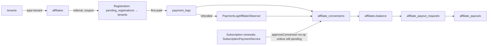

# Dashboard #3: Affiliate / Partner Panel and the Affiliate Lifecycle

> Part of [COMPLETE_SYSTEM_DOCUMENTATION.md](../../COMPLETE_SYSTEM_DOCUMENTATION.md) §8. The business rules are summarised in the repo's `docs/AFFILIATE_SYSTEM.md` and `docs/TENANT_AFFILIATE_PLAN.md`; this file re-verifies them against the code and documents every page. Tags: **[V]** verified, **[I]** inferred, **[R]** recommendation.

## 1. Scope of the program [V]

- Affiliates earn commission when a **referred merchant (new tenant) makes its first paid subscription payment**. Shopper orders on storefronts never generate affiliate commission. The order formulas in `docs/ORDER_FORMULAS.md` do not apply.
- Two affiliate types (`affiliates.type`):
  - `external`: a person who registers at `/affiliate/register`.
  - `tenant`: a vendor store acting as a partner. Created lazily by `TenantAffiliateService::forTenant()` with a synthetic email `tenant-{id}@affiliates.invalid`, a random password, status `active`, and a unique `tenant_id`.
- All `Affiliate*` models use `CentralConnection`. Service transactions run on the central connection, so the code works from inside tenant context.

## 2. Pages (affiliate side)

| Page | URL / route | Component | Content and actions |
|---|---|---|---|
| Login | `/affiliate/login` `affiliate.login` (guest:affiliate) | `Affiliate\Auth\LoginPage` (layout `layouts.auth`, view `livewire.auth.panel-login`) | email, password, remember; rejects inactive accounts ("pending approval"). No social login. **No rate limiting [V]**. |
| Register | `/affiliate/register` `affiliate.register` | `Affiliate\Auth\RegisterPage` | name (≤100), email (unique), password (≥8, confirmed). Creates status `pending` with the default commission from `AffiliateSettings`, so an **admin must activate the account** before login. |
| SSO | `/affiliate/sso/{token}` `affiliate.sso` | `Affiliate\SsoController` | one-time token (sha256 stored in `affiliate_login_tokens`, `used_at` burned atomically, `expires_at`), used by the vendor panel's Partner Program ("open affiliate panel") |
| Dashboard | `/affiliate/dashboard` | `Affiliate\DashboardPage` (layout `layouts.affiliate`) | stat cards: balance, total earned, total paid, total referrals (clicks), conversions (approved + paid), pending; 5 most recent conversions with package |
| Links | `/affiliate/links` | `Affiliate\LinksPage` | referral URL `{central home}?ref={CODE}` with copy; click count; the affiliate's **promo codes** (`affiliate_coupons`), active first |
| Conversions | `/affiliate/conversions` | `Affiliate\ConversionsPage` | paginated conversions, status filter (pending, approved, paid, rejected, refunded) |
| Payouts | `/affiliate/payouts` | `Affiliate\PayoutsPage` | payout history and requests; **request payout** form: amount (min = `AffiliateSettings::minPayout()`, max = requestable = balance minus pending requests), note (≤500) |
| Profile | `/affiliate/profile` | `Affiliate\ProfilePage` | name, PayPal email, bank name, bank account, IBAN (payout details); change password (current, new ≥8, confirmed) |
| Logout | `POST /affiliate/logout` | `Affiliate\AuthController@logout` | — |

The UI uses the shared central look: `resources/css/app.css`, dark-first with `[data-theme]` tokens, DM Sans/Syne fonts (see [ui-ux-design-system.md](ui-ux-design-system.md)).

**Not implemented [V]:** affiliate notifications (no mail or bell for affiliates), affiliate support tickets, multi-tier commissions, per-package commission rules, click deduplication or bot filtering, link/campaign sub-IDs, affiliate reports with charts (only dashboard counters), and automated payouts (all payouts are manual bank or PayPal transfers recorded by an admin).

## 3. Admin side

See [dashboard-admin.md §3.12](dashboard-admin.md#312-affiliates-admin-side). In short:
- **Accounts:** activate, suspend, set commission; filter by type.
- **Pay out:** amount, reference, notes, attachment.
- **Reject** payout requests.
- **Conversions:** reverse.
- **Payouts:** requests queue, details, mark paid, reject.
- **Reports.**
- **Promo codes:** code, affiliate, discount type/value for the merchant, commission, dates, minimum spend, active.
- **Program Settings:** cookie days, default commission type/value, minimum payout (`app_settings` keys `affiliate_*`, which override `config/affiliate.php`: `AFFILIATE_COOKIE_DAYS` = 90, default 10 %, `AFFILIATE_MIN_PAYOUT` = 50).

## 4. Data model [V]

| Table | Key columns / meaning |
|---|---|
| `affiliates` | name, email, password, `code` (unique, uppercase), `type` (external/tenant), `tenant_id` (unique, nullable), status (pending/active/suspended), `commission_type` (percentage/fixed), `commission_value`, `balance`, `total_earned`, `total_paid`, payout profile (PayPal, bank, IBAN) |
| `affiliate_referrals` | `affiliate_id`, ip, user_agent, landing_url, `tenant_id` + `converted_at` once a merchant registers |
| `affiliate_conversions` | `affiliate_id`, `tenant_id`, `affiliate_referral_id`, `affiliate_coupon_id`, `package_id`, `payment_log_id` (**unique**, which makes approval idempotent), `sale_amount`, **snapshotted** `commission_type` / `commission_value`, `commission_amount`, `paid_amount`, `source` (referral/coupon), status, `approved_at` |
| `affiliate_coupons` | code, affiliate, discount type/value (applied to the subscription price), commission value, start/end, minimum spend, active |
| `affiliate_payout_requests` | affiliate, amount, note, status, admin note |
| `affiliate_payouts` | affiliate, amount, reference, notes, attachment, request link |
| `affiliate_login_tokens` | token_hash, affiliate, expires_at, used_at (SSO) |

Full columns are in [database-schema.md](database-schema.md) (central section).

## 5. Complete lifecycle

```mermaid
sequenceDiagram
    actor Af as Affiliate
    participant Web as Central website (track.affiliate)
    actor M as Merchant (visitor)
    participant Reg as RegisterPage / WebsiteRegistrationService
    participant Svc as AffiliateService
    participant Pay as Gateway → payment_logs
    actor Ad as Super Admin
    Af->>Af: register (/affiliate/register) → status pending
    Ad->>Af: activate (AffiliatesListPage)
    Af->>Af: copy link {home}?ref=CODE (LinksPage) or share promo code
    M->>Web: GET any central page ?ref=CODE
    Web->>Svc: trackClick(): affiliate_referrals row + cookie neo_aff (90d, Lax, HttpOnly)
    Note over Web: only if no neo_aff cookie yet (first referrer wins); only active affiliates
    M->>Reg: registers (optionally enters promo code → validateCoupon: window, active affiliate, min spend, self-use)
    Reg->>Svc: markReferralConverted(referral, tenantId) → conversion pending (rate snapshot)
    M->>Pay: pays first paid package
    Pay->>Svc: approveConversion(tenant, paymentLog) or approveCouponConversion(...)
    Svc->>Svc: self-referral? → rejected. inactive affiliate? → stays pending
    Svc->>Svc: commission = commissionFor(snapshot type, value, amount) → approved; balance += commission; forget cookie
    Af->>Svc: requestPayout(amount ≤ requestable, ≥ min) (PayoutsPage or vendor Partner page)
    Ad->>Svc: issuePayout(): lock, amount ≤ balance, ≥ min unless paying the full balance, allocate oldest-first to conversions (paid_amount; paid when covered)
    Ad-->>Af: transfer money manually (bank/PayPal), record reference + attachment
    opt payment refunded
        Pay->>Svc: PaymentLogAffiliateObserver → reverseForPaymentLog(): conversion refunded, balance −= commission (may go negative = clawback)
    end
```

### 5.1 Step-by-step rules and status

| Step | Implementation | Status / gaps |
|---|---|---|
| Registration and onboarding | `RegisterPage` → pending; admin activates | implemented. No email verification or welcome mail for affiliates [V] |
| Authentication | session guard `affiliate`; password reset broker `affiliates` exists in `config/auth.php` | implemented. **No forgot-password route under `/affiliate`** [V: the route list has no affiliate password routes]. No login throttle |
| Referral link | `Affiliate::referralUrl()` = `route('website.home').'?ref='.code` | implemented. Only the home URL is offered, but `track.affiliate` wraps all public website routes, so `?ref=` on any of them works [V] |
| Visitor tracking | `TrackAffiliateReferral` → `trackClick()`; cookie `neo_aff` = referral id, lifetime `cookieDays × 24 × 60` minutes | implemented. **Every first visit creates a row; no bot or duplicate filtering** [V] |
| Attribution | `resolveReferral()` reads the cookie at registration; first referrer wins (cookie not overwritten) | implemented |
| Conversion | `markReferralConverted()` (row lock, once per referral) → `affiliate_conversions` pending with snapshot rate | implemented |
| Coupon attribution | `approveCouponConversion()`: a coupon beats the URL referral; an existing conversion for the same affiliate and tenant is upgraded (the higher commission wins, only the difference is credited); the coupon and URL paths never double-pay | implemented |
| Commission calculation | `Affiliate::commissionFor()`: percentage = `round(sale × v / 100, 2)`; fixed = `min(v, sale)` | implemented. Renewals never earn [V docblock] |
| Commission approval | **automatic** on the first paid payment, idempotent per `payment_log_id` (unique index) | implemented. There is no manual "approve" step; the admin can only reverse |
| Statuses | `pending → approved → paid`; `rejected` (self-referral); `refunded` (reversal) | implemented |
| Wallet / balance | `affiliates.balance`, `total_earned`, `total_paid` (can go negative after a clawback, which blocks payouts) | implemented |
| Withdrawal request | `requestPayout()`; `requestableAmount()` = balance − pending requests | implemented |
| Payment | `issuePayout()` by the admin; FIFO allocation to conversions; attachment upload | implemented (manual money movement) |
| Payment methods | payee profile fields only (PayPal email, bank, IBAN); no gateway payouts | partial |
| Reports | admin `AffiliateReportsPage`; affiliate dashboard counters | partial |
| Notifications | none for affiliates | **missing** |

### 5.2 Self-referral protection [V]
- Rejected when the affiliate's email equals the new tenant's email. For tenant affiliates it is also rejected when `tenant_id` equals the new tenant, or when the owning tenant's email equals the new tenant's email.
- Coupon self-use is blocked at apply time (`validateCoupon` with email) and again at approval.

## 6. Vendors as affiliates (Partner Program)

| Item | Implementation [V] |
|---|---|
| Page | vendor panel `/admin/partner-program` (`tenant.partner-program`, `Finance\PartnerProgramController`, permission `finance.wallet.view`); dashboard banner `resources/views/tenant/pages/dashboard/_partner.blade.php` |
| Stats | `TenantAffiliateService::stats()`: link visits (= referrals count), registered traders (referrals with `converted_at`), paying (conversions approved/paid), +N in 30 days, balance, total earned, total paid, pending requested, requestable, minimum payout |
| Link | `TenantAffiliateService::referralUrl()` → `{scheme}://{central_domains[0]}/?ref={code}`; Copy and share buttons (`partner.js`) |
| Tables | `PartnerWalletController@conversionsData` (merchant id **masked**, package, sale, commission, status, date) and `@payoutsData`, both scoped to the current tenant's affiliate (the id is never accepted from the request) |
| Withdraw | `PartnerWithdrawRequest` (amount, note) → `AffiliateService::requestPayout()` → appears in admin Affiliates → Payouts |
| SSO | `PartnerWalletController@sso` → `TenantAffiliateService::loginUrl()` → `/affiliate/sso/{token}`: **the tenant affiliate can use the affiliate panel through SSO** although `docs/AFFILIATE_SYSTEM.md` says tenant rows are "non-login" (password login is effectively impossible because of the random password; SSO deliberately allows access) [V] |
| Ledger separation | partner balance (`affiliates.balance`) is never mixed with vendor order money (`vendor_settlements`, `tenant_payouts`) |

## 7. Connections to other modules



`SubscriptionPaymentService::…` calls `approveConversion()` too. This covers a tenant whose first *paid* payment happens later, after a free or trial registration. In that case the pending conversion is approved at that time [V].

## 8. Rebuild recommendations [R]
1. Introduce a ledger (`affiliate_ledger_entries`: credit, debit, reversal, payout) instead of mutating `balance` / `total_*` columns, and derive balances from it.
2. Add click deduplication (per affiliate + IP/UA per 24 h) and a bot filter. Store the UTM/sub-id.
3. Configure commission rules per package and per term, with an optional hold period (e.g. approve after a 14-day refund window) instead of instant approval.
4. Add affiliate notifications (conversion approved, payout paid), password reset, email verification and login throttling.
5. Support payout methods through gateways (PayPal Payouts, Stripe Connect) where available, keeping manual payouts.
6. Make tenant partners first-class: one `partners` concept with `partner_type` and no synthetic emails.
