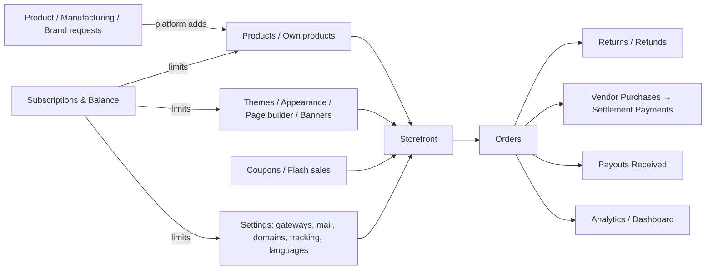

# Dashboard #2: Tenant (Vendor) Administration Panel

> Part of [COMPLETE_SYSTEM_DOCUMENTATION.md](../../COMPLETE_SYSTEM_DOCUMENTATION.md) §7. Every route, handler method, FormRequest field and view for this panel is in the generated [module-inventory.md §Tenant (vendor) admin panel](module-inventory.md#tenant-vendor-admin-panel-424-routes). Architecture conventions are in the repo's `docs/tenant-panel-refactor.md`. Tags: **[V]** verified, **[I]** inferred, **[R]** recommendation.

## 1. Overview

| Item | Value |
|---|---|
| Purpose | Run one store: catalog markup and own products, orders, returns, customers, storefront design, marketing, finance with the platform, settings, staff |
| Users | vendor staff (`admins` in the **tenant DB**), default roles `Store Owner`, `Manager`, `Support` (`App\Models\Tenant\AdminRole::defaultRoleDefinitions()`) |
| URL | `{store-subdomain or custom domain}/admin`; `/admin` → `LoginController@redirectToStart`; login `tenant.login` |
| Middleware | `web`, `InitializeTenancyByDomain`, `PreventAccessFromCentralDomains`, `SetTenantPanelLocale` (cookie-based UI language), `auth:tenant`, `EnsureTenantTourSeen` (`tenant.tour`), `tenant.permission:{key}`, `tenant.setup:{step}` [V] |
| Stack | Controllers `app/Http/Controllers/Tenant/Panel/{Auth,Catalog,Finance,Insights,Onboarding,Requests,Sales,Settings,Shell,Store,Support}` extending `PanelController`; FormRequests extending `TenantFormRequest`; Blade `resources/views/tenant/pages/**` using `x-tenant::*` components; JS `resources/js/tenant/{core,components,modules,pages}`; DataTables server side (`TenantPanelRepository::query*` + `DataTables::eloquent`) [V] |
| AJAX contract | success `{success, message, data?, redirect?}`; 422 validation `{message, errors}`; failure `{success:false, message, toast_type?}`; 401 → login, 403 toast, 409 setup-incomplete redirect, 419 reload [V `docs/tenant-panel-refactor.md` §2] |
| Pattern per page | `index` (Blade shell) + `data` (DataTables JSON) + `store`/`update`/`destroy` + `validate*` (validate-on-blur using the same FormRequest) + `export` (CSV) [V] |

## 2. Sidebar (`App\Helpers\TenantNavigation`) [V]

| Section | Item | Route | Permission |
|---|---|---|---|
| Overview | Dashboard | `tenant.dashboard` | dashboard.view |
| | Products (also active for own-products, categories, badges) | `tenant.products.index` | catalog.products.manage |
| | Orders › All Orders / Returns / Refunds / Return Analytics | `tenant.orders.index`, `tenant.returns.index`, `tenant.refunds.index`, `tenant.returns.analytics` | sales.orders.view, sales.returns.manage |
| | Customers | `tenant.customers.index` | sales.customers.manage |
| | Your Store › Themes / Page Builder / Pages / Appearance / Banners / Blade Theme | `tenant.store.*` | store.*.manage |
| | Ads & Marketing › Coupons / Flash Sales | `tenant.store.coupons.index`, `tenant.store.flash-sales.index` | store.coupons.manage, store.flash-sales.manage |
| | Analytics | `tenant.analytics` | analytics.view |
| | Request product › Product / Manufacturing / Brand Requests (unread badge) | `tenant.product-requests.index`, `tenant.manufacturing.index`, `tenant.brand-requests.index` | catalog.products.manage (**nav only; routes 2 and 3 are not permission-guarded**) |
| | Partner Program | `tenant.partner-program` | finance.wallet.view |
| | Settings › Account, General, Currencies, Languages Manage, AI Translation, Tenant Admins, Roles & Permissions, Payment Gateways, Return Policy, Email Templates, Mail Configurations, Domains, Tracking, Compliance Center | `tenant.settings.*` | settings.*.manage |
| More | Finance › Subscriptions & Balance, Billing, Vendor Purchases, Settlement Payments, Payouts Received | `tenant.finance.*` | finance.*.view |
| | Get Started (hidden when setup is complete) | `tenant.onboarding?tab=tour` | — |
| | Notifications, Support, Documentation | `tenant.notifications.index`, `tenant.support.index`, `tenant.help.index` | dashboard.view / — |
| | Website URL (external link to the storefront) | — | — |

Commented out in code: "Today's chances" (`tenant.todays-chances`, the route exists), Mobile App, App Themes, Languages (legacy), Subscribers, Buy Languages [V].

## 3. Modules

### 3.1 Dashboard (`Insights\DashboardController@index`, `resources/views/tenant/pages/dashboard/*`)
- Period selector (`periodMonths`); KPI cards (`Metric::cards`); order-status rows; chart payload.
- Tables: latest orders (Order, Customer, Total, Gateway, Created), top customers (Customer, Orders, Total Spend, Last Order), top products (Product, Units, Revenue, Gross Profit, Margin).
- Partials:
  - `_hero` and `_pay-alert`: the amount owed to the platform, linking to settlement;
  - `_partner`: Partner Program banner with invite link, visits, traders, reward (`TenantAffiliateService::stats()`);
  - `_opportunities` / `_opp-flash-sale-modal`: suggested flash sales;
  - `_new-in`: new central products to add;
  - `_ads`: AI social posts via `SocialPostService`;
  - `_storefront`: live store preview with a country selector (`?preview_country=XX`);
  - `_product-request`, `_brand`, `_performance`.
- Account setup progress widget: `Shell\SetupProgressController` (`tenant.widgets.*`) plus the 8 setup steps in `TenantNavigation::allSetupStepsDone()` [V].

### 3.2 Products (catalog markup): `products/*` (29 routes)
- **Business purpose:** decide which central products appear in the store and at what markup.
- **List** (`ProductsListController`):
  - DataTable; toggle active and featured;
  - "new products" from central (`newProducts`, `previewNew`, `syncNew`) imports newly published central products in the tenant's categories.
- **Edit** (`ProductController` + `SaveProductRequest`):
  - fields: `central_product_id`, `price`, `active`, `featured`, `category_ids`, `badge_ids`, per-locale fields, `stock_override`, `weight_grams_override`;
  - per variant: `real_price`, `sell_price`, `profit_margin`, `active`;
  - `centralSearch` / `centralSnapshot` show the central product read-only.
  - Platform-owned fields are protected by `CentralWriteGuard` / `ReadOnlyCatalogRowException` (422 message) [V].
- **Modals** (`ProductModalsController`):
  - **price list** (per-country profit type/value, per variant), preview and save → `ApplyTenantProfitPercentageJob` / `TenantPricingService`;
  - **AI price** (`PriceFinderService` → Python, optionally using the product image);
  - **social posts** (language, platform, include image);
  - **share**.
- **AI translation** of a product (`ProductAiTranslationController@translate`; gated by the plan's `aiTranslationEnabled` and `ai_calls_limit`).
- **Sort** (`ProductSortController`).
- **Edit requests** (`EditRequestsController`): history of change proposals sent to the platform.
- **Pricing rule:** unit price = central cost + vendor profit (percentage or fixed) + fixed shipping (country/weight). The formula is in `docs/ORDER_FORMULAS.md` §1. The default markup is `profit_percentage` in General Settings (`SaveGeneralSettingsRequest`).
- **Limits:** `PlanLimitService` `products_limit`.

### 3.3 Own products: `own-products/*`
- `OwnProductsListController` (list, delete); `OwnProductController` + `SaveOwnProductRequest`:
  - sku, slug, base / sale / cost price, stock, min stock, manage stock, taxable, weight, active, featured, categories, badges;
  - **countries** (sold-in list: `NULL` = everywhere, `[]` = nowhere, `[ids]`), primary image, variants.
- **Rules [V]:**
  - priced from the vendor's form (cost 0, profit = sell price);
  - **free shipping**;
  - visible only in the listed countries (detected visitor country, strict);
  - checkout refuses shipping to an unlisted country;
  - **fulfilled by the vendor** (the only orders whose shipping status the vendor can change).

### 3.4 Categories and badges
- `CategoryController`:
  - tenant category rows linked to central categories (`central_category_id`), with order number, active, featured, thumbnail;
  - toggle active/featured, delete; sort (`CategorySortController`); products in a category (`CategoryProductsController`).
- `BadgeController` / `BadgeSortController`: assign products to badges (search, assign a whole category), sort. Badges drive home sections.
- **Limits:** categories are restricted to the tenant's selected `category_ids`. Changes go through a **category change request** (`GeneralSettingsController@submitCategoryRequest` → admin approval).

### 3.5 Orders: `orders/*`
- **List** (`OrdersController@index|data|export`): columns order, customer, value, "vendor owes platform" (`_cols/vendor-own-platform`), status badge; CSV export.
- **Detail** (`show`):
  - line items (static `x-tenant::table`), totals per `OrderPricing`, settlement figures (`OrderProfitCalculator`, `OrderPayoutLedger`).
  - Actions:
    - `updateShippingStatus` (**own-products orders only**; otherwise 403);
    - `cancel` (`sales.orders.manage`, reasons from `CancellationReason`);
    - `storeRefund` (manual refund: amount, reason; `sales.returns.manage`).
- **Pay platform** for a vendor-collected order: `tenant.vendor-settlement.*` (`VendorSettleOrderController@show|breakdown|settle`) → `VendorPurchaseService::previewBreakdown()` → gateway → `VendorSettlement` (central) [V].
- **Data location:** orders live in the tenant DB. Returns, refunds, attachments and settlements live in central tables filtered by `tenant_id`.

### 3.6 Returns and refunds: `returns/*` (25 routes), `refunds/*`
- `ReturnController` actions: approve (note), reject (reason), request more info, mark item received, inspect (result, notes, restock), issue refund (amount), mark exchange shipped (tracking), mark exchange completed, convert to refund, mark refunded, close, add note. Each has a matching `Sales\*Request`.
- The state machine is `ReturnStatus::allowedTransitions()` (see the master doc §12).
- `RefundController`: retry, complete (reference), reject (reason).
- `ReturnAnalyticsController`: charts and data.
- **Return Policy** (`Settings\ReturnPolicyController`): window days, non-returnable categories, fee, conditions, reasons that require a video. It overrides the platform default; per-product overrides live on `products`.

### 3.7 Customers: `customers/*`
- List (export, delete); create (`StoreCustomerRequest`: full name, email, phone, address, country, city, password, active).
- Detail (`CustomerDetailController`): profile update, toggle active, payment history data, addresses CRUD (`SaveCustomerAddressRequest`), cities by country.
- Table: tenant `customers`, `customer_addresses`. Social login columns `provider` and `provider_id`.

### 3.8 Your Store (storefront design)
| Page | Controller | Behaviour |
|---|---|---|
| Themes | `Store\ThemesController` | pick a built-in theme or approved Blade theme; activate/deactivate; **per-country theme and home-variant** (`theme_country`, `tenant_home_variants`); country lists |
| Home Variants | `Store\HomeVariantsController` | select the predefined home layout variant |
| Page Builder | `Store\PageBuilderController` | reorder and toggle home sections (`tenant_page_sections`, keys from `SectionRegistry`) |
| Pages | `Store\PagesController`, `PageFormController` | CMS pages (slug, active, translated content) → `/pages/{slug}`; default footer pages are seeded (`pages:seed-footer-defaults`) |
| Appearance | `Store\AppearanceController` (19 routes) | general (logo builder incl. AI logo `LogoGeneratorService`), **colors and fonts** (LTR/RTL fonts; reset), promo banner (title, subtitle, link, CTA, desktop/mobile image), top-header links, **footer** (logo mode text/image, AR/EN text, colors, shape, fonts, width), social links (`SocialLinkController`) |
| Banners | `Store\BannerController` | hero/slider banners (URL, order, image, country scope `banner_country`); limited by plan `banners_limit` |
| Blade Theme | `Store\BladeThemeController` + `BladeThemeStarterKitController` | upload a theme ZIP (`theme_zip`) → pending admin review; deactivate, delete; download the starter kit. See `docs/blade-theme-variants-lifecycle.md` |
| Mobile app / App themes | `Store\MobileAppController` | app settings, themes, colors (**nav hidden**) |

### 3.9 Marketing
- **Coupons** (`Store\CouponController`, documented example in `docs/tenant-panel-refactor.md` §3): per-country list; code unique, name, type `fixed|percentage`, value, minimum spend, dates; `coupon_source = vendor`.
- **Flash sales** (`Store\FlashSaleController`): products, discount %, dates, active, banner image; attach a product from its page (`availableForProduct`, `attachProduct`). The vendor's flash sale reduces the vendor share only.

### 3.10 Analytics: `analytics/*`
Order analytics (monthly, by status), product profitability, customer lifetime value, shipping analytics, each a `viewData` + `data*` JSON pair rendered with Chart.js (`resources/css/tenant/components/charts.css`).

### 3.11 Requests to the platform
- **Product requests** (`Requests\ProductRequestController`): title, description, product URL, files; reply thread with attachments; real-time via `tenant.{id}.product-requests`.
- **Manufacturing** (`Requests\ManufacturingController`): product name, description, quantity, linked product, reference URL, images; chat; cancel; **pay** a payment request (gateway routes `tenant.manufacturing-payment.*`); export. **No `tenant.permission` middleware** [V].
- **Brand requests** (`Requests\BrandRequestController`): title, description, files; chat; pay; delete. **No permission middleware** [V].

### 3.12 Partner Program (`Finance\PartnerProgramController`, `PartnerWalletController`)
See [dashboard-affiliate.md §6](dashboard-affiliate.md#6-vendors-as-affiliates-partner-program): referral link, stats, conversions and payout tables, withdraw request (`PartnerWithdrawRequest`: amount, note), and SSO to the affiliate panel.

### 3.13 Finance
| Page | Controller | Data |
|---|---|---|
| Subscriptions & Balance | `Finance\WalletController` | tenant `subscriptions` + `transactions` tables; **subscribe/renew** a package (`SubscribeRequest`) → `tenant.subscription-payment.*` (`SubscriptionPaymentController`) → central `payment_logs`, `invoices`, affiliate approval on first payment |
| Billing | `Finance\BillingController` | invoices list/detail (central `invoices` for this tenant) |
| Vendor Purchases | `Finance\VendorPurchaseController` | vendor-collected orders and what is owed to the platform (paid via, gateway fee, settlement state); export |
| Settlement Payments | `Finance\SettlementPaymentsController` | central `vendor_settlements` for this tenant |
| Payouts Received | `Finance\PayoutsController` | central `tenant_payouts` for this tenant |
| Buy Languages | `Finance\BuyLanguageController` (nav hidden; replaced by Languages Manage) | paid language purchase |

### 3.14 Settings
| Page | Key fields / actions |
|---|---|
| Account | admin name/email, phone, shop name, description, address, password (`UpdateAccountRequest`) |
| General | default **profit percentage**; submit **country** and **category change requests** |
| Currencies | toggle active, make default (central currencies list) |
| Languages Manage | available languages, toggle, default, **purchase paid languages** (`tenant.language-purchase.*` gateway flow) |
| AI Translation | run AI translation of catalog and store texts, history, purchase AI translation (`tenant.ai-translation-purchase.*`), status polling |
| Translations (store strings) | `tenant.settings.translations` is now only a redirect to AI Translation (`routes/tenant_panel.php:793`); `Panel\Settings\TranslationsController` (save key, AI-translate keys) is **unrouted / dead**. Admin can lock keys from vendor override (Translation Key Access) |
| Tenant Admins | CRUD admins (role, name, email, password, status), activate/deactivate |
| Roles & Permissions | CRUD roles with the 32 permission keys |
| Payment Gateways | list central-provided gateway types; **use own credentials** (`use_own`, `required_fields`), sandbox mode, set primary, **check connection** (`GatewayConnectionChecker`); payment readiness checklist |
| Return Policy | see §3.6 |
| Email Templates | edit subject/body per locale, active, **resync from central** |
| Mail Configurations | own SMTP (mailer, host, port, username, password, encryption, from), send test |
| Domains | add/update/delete a custom domain, **check DNS** against the admin's `dns_records` template; the admin marks it connected |
| Tracking | Facebook / TikTok / Snapchat pixel IDs, GA4 Measurement ID (`G-…`) |
| Compliance Center | owner identity, company, registration number and expiry, VAT, registration document, bank (holder, account, IBAN), currency, documents (national ID…) |
| Subscribers | storefront newsletter subscribers list/export/delete (**nav hidden**) |

### 3.15 Onboarding, notifications, support, help
- **Onboarding** (`OnboardingController`): tabs (tour/setup), complete tour, upload logo, skip payment readiness, dismiss. `EnsureTenantTourSeen` redirects new users to the tour.
- **Notifications** (`Support\NotificationsController`): page, feed, latest, open (resolves the link through `NotificationLinks`), mark read / all read; Reverb `tenant.{id}.notifications`.
- **Support tickets** (`Support\TicketController`): subject, category, body; replies; thread polling or live (`tenant.{id}.support`).
- **Help / Documentation** (`Support\HelpController`): articles (getting started, page builder, themes, tracking pixels, API reference, custom template guide, variable reference).
- **UI kit** `/admin/_ui`: an internal component showcase.

## 4. Tenant data ownership and isolation

| Data | Location | Isolation mechanism |
|---|---|---|
| Products (overrides/own), categories, badges, coupons, flash sales, banners, pages, themes config, settings, customers, orders, subscriptions, transactions, admins, roles, translations, notifications | **tenant DB** | physical: separate database per tenant (`DatabaseTenancyBootstrapper`) |
| Uploaded files | `storage/tenant{id}/…` | filesystem bootstrapper suffix |
| Cache | tagged per tenant | `SafeCacheTenancyBootstrapper` |
| Returns, refunds, order attachments, settlements, payouts, support tickets, product/manufacturing/brand requests, domain requests, affiliate partner rows, compliance data on `tenants` | **central DB** with `tenant_id` | **application-level** filters (`where('tenant_id', tenant('id'))`) on `CentralConnection` models. Example from `docs/TENANT_AFFILIATE_PLAN.md`: "never accept an affiliate id from the request" |
| Central catalog (products, variants, categories…) | central DB | read-only through merged readers + `CentralWriteGuard`; tenant-targeted rows (`product_tenant_assignments`, targeted coupons/flash sales) must be filtered by tenant |

**Risk [V/I]:** any controller that loads a central row by id without a tenant filter leaks data across tenants. There is no global scope enforcing it. **[R]** In the rebuild, every central table with `tenant_id` gets a mandatory `TenantOwned` global scope, plus an automated test that hits each vendor endpoint with another tenant's ids.

## 5. Module relationships (vendor operations)

## 6. Vendor-panel issues
| Issue | Evidence | Priority |
|---|---|---|
| 53 authenticated business routes without `tenant.permission` (manufacturing, brand requests, support, purchase callbacks, vendor-settlement, compliance) | route list | High |
| ~35 dead Livewire panel classes still on disk although documented as deleted | `app/Livewire/Tenant/{Finance,Store,Setting,Analytics,…}` | Medium |
| Duplicate `App\Http\Controllers\Tenant\ComplianceCenterController` (unrouted) next to `Panel\Settings\ComplianceCenterController` | dead-code scan | Low |
| Hidden but routed features (mobile app, subscribers, buy languages, today's chances) of unclear product status | `TenantNavigation` comments | Low: decide keep or drop |
| Heavy dependence on jQuery + select2 + DataTables in an otherwise vanilla-JS panel | `resources/js/tenant` | Low |
