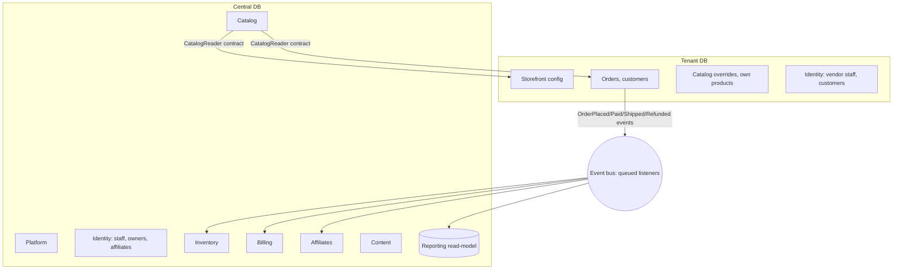
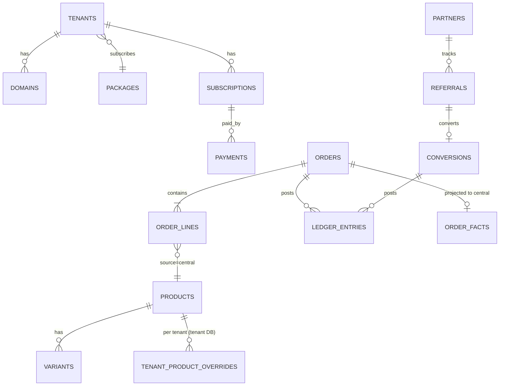

# New Project Blueprint and Recommendations

> Part of [COMPLETE_SYSTEM_DOCUMENTATION.md](../../COMPLETE_SYSTEM_DOCUMENTATION.md) §20–24. Everything here is a **recommendation [R]**, grounded in the findings of the master document (§18 security, §19 problems). It preserves the business concept, the four dashboards, the storefront experience, the visual identities and the money formulas (`docs/ORDER_FORMULAS.md`). The formulas carry over unchanged.

## 1. Recommended architecture

### 1.1 Style: modular monolith, multi-database tenancy
One Laravel application with explicit **modules (bounded contexts)**. Each module owns its models, migrations, actions, queries, events, policies, HTTP layer and tests, and talks to other modules only through **public contracts** (interfaces + DTOs) and **domain events**. This keeps the single-deployment simplicity of today while removing the god classes (`StorefrontRepository`, `TenantAdminAggregateService`) and the cross-module DB reach-through.



### 1.2 Why it is better than today
| Today | Proposed | Benefit |
|---|---|---|
| Admin lists loop every tenant DB and paginate in PHP | `Reporting` module: listeners write `order_facts`, `customer_facts` and `ledger_entries` centrally on each domain event; admin screens query SQL with indexes | O(page) instead of O(tenants × rows) |
| Catalog copies (`sync`) + merged reads (`central`) in parallel | single `CatalogReader`: central rows + tenant override rows + own products, cached per tenant with a version stamp | one code path; no sync queue |
| Vendor Blade themes executed as PHP | `StorefrontExperience` module: JSON page schema + section components + design tokens; optional **sandboxed** custom templates (Twig sandbox or Liquid) with an allow-list of variables | removes RCE risk |
| Permissions declared per route by hand (53 vendor routes missed) | deny-by-default: every route in a panel group must declare `can:` / a policy, enforced by an architecture test | no silent gaps |
| No audit trail | `Identity\Audit` (central `audit_events`: actor, guard, tenant, action, subject, diff, ip, ua) incl. impersonation | compliance, forensics |
| Derived balances (`affiliates.balance`, ledger recomputed from orders) | `Billing\Ledger` double-entry journal (accounts per tenant, platform, affiliate; entries per order, settlement, payout, subscription, commission) | reconcilable money |
| Two UI stacks + three token systems | one Blade component library `x-ui::*` + Alpine.js + fetch, themed per surface; storefront section components | consistency, less code |

### 1.3 Tenancy design
- **Keep DB-per-tenant** for tenant-private data (customers, orders, carts, reviews, overrides, own products, storefront config, vendor staff). It is the strongest isolation already in place.
- **Central data with a `tenant_id`** (returns, refunds, settlements, payouts, requests, tickets, domains, partner rows): access only through repositories that apply a mandatory `BelongsToCurrentTenant` global scope when tenancy is initialized, plus an architecture test that fails if a `CentralConnection` model with `tenant_id` lacks the scope.
- **Identification:** domain/subdomain (primary), slug path (indexed physical `tenants.slug` column), mobile `X-Tenant` plus a **per-tenant publishable API key** (not the tenant id).
- **Provisioning:** keep the DB pool and the queued `ProvisionTenant` pipeline. Add idempotent steps with status (`provisioning_steps` table) and a retry UI.

## 2. Recommended technology stack

| Concern | Choice | Justification |
|---|---|---|
| Runtime | PHP 8.3+, **Laravel 13** | the team's current expertise; Laravel 13 is already in use; no reason to switch frameworks |
| Tenancy | **stancl/tenancy v3** (evaluate v4) | already proven here (bootstrappers, DB pool); keep the custom Safe* bootstrappers |
| DB | MySQL 8 (one central schema + one per tenant) | current; supports the needed JSON and indexes |
| Cache / queue / locks | **Redis** + **Laravel Horizon** | today's DB/file cache cannot tag (see the impersonation controller comment); Horizon gives per-queue supervision and fixes the unconsumed-queue problem |
| Real-time | Laravel Reverb | already used for bell and chats |
| Admin, vendor, affiliate, owner UI | **Blade components + Alpine.js + fetch JSON** (the vendor-panel pattern) | matches the "no Livewire for new UI" rule; the vendor panel already proves the pattern; one library for all panels |
| Tables | server-side JSON endpoints + a small table component (or keep DataTables 2 without jQuery plugins where possible) | removes jQuery/select2 weight over time |
| Storefront | server-rendered Blade **section components** + Alpine for interactivity; Swiper for carousels | SEO, fast first paint, theme variants via props/tokens |
| CSS | **Tailwind v4 only** + token CSS per surface | drop the Tailwind v3 build |
| Payments | keep the `PaymentGateway` strategy layer (29 drivers) behind a `PaymentGatewayContract`; add webhook signature verification per driver | proven; widest market coverage |
| AI | keep the Python FastAPI sidecar for embeddings, logo and price finder; call OpenAI from PHP for translation | isolates Python deps; already deployed |
| Files | Flysystem with S3-compatible storage (tenant prefix) + CDN | horizontal scaling; today is local disk only |
| Testing | **Pest** (feature/unit/architecture) + Playwright e2e | architecture tests enforce module boundaries and permission coverage |
| Quality | Pint, Larastan (level 6+), Rector | prevent the drift seen today |
| Observability | Sentry (or similar), Laravel Pulse, structured logs with `tenant_id` | — |

## 3. Proposed module structure (bounded contexts)

| Module | Owns (tables) | Main capabilities | Publishes |
|---|---|---|---|
| **Platform** | tenants, domains, db_pool, packages, plan_limits, tenant_change_requests, maintenance_windows, app_settings, compliance | registration, provisioning, plans and limits, custom domains, compliance, maintenance | TenantProvisioned, PlanChanged |
| **Identity** | staff (central), vendor_staff (tenant), owners, customers (tenant), roles, permissions, tokens, audit_events | all guards, RBAC, SSO, impersonation, social login | UserLoggedIn, ImpersonationStarted |
| **Catalog** | products, variants, variations, categories, badges, labels, product_country, tenant_assignments, tenant overrides (tenant DB), own products (tenant DB), edit requests, image embeddings | central catalog, vendor overrides and markup, own products, search (text + image) | ProductPublished, PriceChanged |
| **Inventory & Fulfilment** | branches, stock (per branch), shipping zones, rates, fixed shipping, shipping days, stops, delivery queue, attachments | stock reservation/deduction, shipping quotes, delivery queue, labels | StockLow, ShipmentDispatched |
| **Commerce** | carts, orders, order_items, order_activities, coupons, flash sales | cart, checkout (`OrderComposer`, `OrderPricing`), order lifecycle, cancellations | OrderPlaced, OrderPaid, OrderStatusChanged, OrderCancelled |
| **AfterSales** | return_requests, media, notes, refunds | returns state machine (`ReturnStatus`), refunds (`RefundCalculator`) | ReturnApproved, RefundCompleted |
| **Billing & Ledger** | subscriptions, payment_logs, invoices, ledger_accounts, ledger_entries, vendor_settlements, tenant_payouts, paid add-ons | subscriptions and renewals, add-on purchases, settlements and payouts, invoices | PaymentSucceeded, PaymentRefunded |
| **Affiliates** | partners, referrals, conversions, promo codes, payout requests, payouts (ledger-backed) | tracking, attribution, commission, payouts | CommissionApproved |
| **Storefront Experience** | themes, theme_countries, page schemas, sections, banners, menus, pages, appearance tokens, tracking pixels, SEO | theme rendering, page builder, preview | — |
| **Content & i18n** | blog, static pages, FAQs, email templates, languages, translations, overrides, currencies | CMS, translations (incl. AI), currencies | — |
| **Engagement** | notifications, support tickets, product/manufacturing/brand requests + messages + payment requests, newsletter | bell, chats, tickets, requests | — |
| **Integrations** | gateway configs, AI settings, mail configs | gateway drivers, AI clients, mail transport per tenant | — |
| **Reporting** | order_facts, customer_facts, daily_tenant_metrics | admin dashboards, ledgers, analytics for admin and vendor | — |
| **MobileApi / PublicApi** | api_keys, mobile tokens, device tokens | versioned JSON APIs, push (FCM/APNs) | — |

## 4. Proposed database design

### 4.1 Principles
1. **Distinct names per schema**: central tables that mirror tenant concepts get explicit names (`platform_staff` vs `vendor_staff`, `platform_email_templates` vs `store_email_templates`). This removes the `admins` / `languages` / `files` name collisions.
2. **Money as integer minor units + currency** on every amount column (`amount_minor BIGINT`, `currency CHAR(3)`). Keep the `OrderPricing` formulas and round once at line level, as today. This allows charging in local currency later instead of USD-only.
3. **Physical columns for hot tenant attributes** (`slug`, `status`, `package_id`, `launch_ready`, `provision_status`); keep `data` JSON only for rare settings.
4. **Typed polymorphic catalog references** on order lines (`product_source ENUM('central','own')`, `product_ref BIGINT`, plus an immutable snapshot JSON: name, sku, options, image). Today's `catalog_product_id` / `product_type` work already points this way.
5. **Soft deletes on all catalog entities** (already added for central variants in the dedup plan).
6. **Ledger tables**: `ledger_accounts(id, owner_type, owner_id, kind)` and `ledger_entries(id, journal_id, account_id, debit_minor, credit_minor, currency, source_type, source_id, created_at)` with unique `(source_type, source_id, account_id)` for idempotency.
7. **Reporting facts**: `order_facts(tenant_id, order_id, order_uuid, placed_at, status, payment_status, collected_by, grand_total_minor, platform_profit_minor, vendor_profit_minor, country_id, customer_hash, …)` indexed by `(tenant_id, placed_at)`, `(status, placed_at)`.
8. **Audit**: `audit_events(id, occurred_at, actor_type, actor_id, guard, tenant_id, action, subject_type, subject_id, changes JSON, ip, user_agent)`.

### 4.2 Key entity sketch



### 4.3 Indexes to add from day one
`tenants(slug)` unique · `domains(domain)` unique · `order_facts(tenant_id, placed_at)` · `products(status, published_at)` · `product_country(country_id, product_id)` · `category_product(category_id, sort)` · `affiliate_referrals(affiliate_id, created_at)` · `return_requests(tenant_id, status)` · `refunds(tenant_id, status)` · `vendor_settlements(tenant_id, order_uuid)` · `ledger_entries(account_id, created_at)`.

## 5. Proposed folder structure

```
app/
  Modules/
    Platform/        {Models, Actions, Queries, Http/{Admin,Website}, Events, Listeners, Jobs, Policies, Database/{migrations,central}, Tests}
    Identity/        {…, Audit/}
    Catalog/         {…, Readers/CatalogReader.php, Overrides/, Search/}
    Inventory/
    Commerce/        {…, Pricing/OrderPricing.php, Checkout/OrderComposer.php, Lifecycle/}
    AfterSales/
    Billing/         {…, Ledger/, Gateways/ (PaymentGateway drivers)}
    Affiliates/
    Storefront/      {Http/, Sections/, Themes/{elora,souqify,ecommet}/, PageSchema/}
    Content/
    Engagement/
    Integrations/    {Ai/, Mail/, Python/}
    Reporting/       {Projectors/, Queries/}
    Api/             {Public/V1, Mobile/V1}
  Shared/            {Tenancy/, Money/, Http/JsonResponse, Support/, UI/ (view components)}
database/
  migrations/central/ (per module, loaded by module service providers)
  migrations/tenant/
resources/
  views/ui/            x-ui::* components (shared panels)
  views/panels/{admin,vendor,affiliate,owner}/
  views/storefront/sections/{hero,trust-bar,product-rail,category-strip,…}.blade.php
  css/tokens/{admin,vendor,website,storefront}.css
  js/{core,panels,storefront}/
routes/ (thin: each module registers its own route files)
tests/{Architecture,Feature/<Module>,Unit/<Module>,e2e}
```

## 6. Implementation roadmap

| Phase | Scope | Depends on | Priority |
|---|---|---|---|
| 0. Foundations | repo, CI (Pint, Larastan, Pest, Playwright), module skeleton, tenancy bootstrappers, Redis/Horizon, `x-ui` component library + 4 token themes, audit log, architecture tests (permissions, module boundaries, tenant scope) | — | Critical |
| 1. Platform & Identity | central staff RBAC (87 permissions mapped), owners, registration + email verification, packages and limits, provisioning pipeline + DB pool, domains, compliance, impersonation with audit | 0 | Critical |
| 2. Catalog & Inventory | central catalog CRUD, variations, categories, badges, labels, countries, branches and stock, shipping zones, fixed shipping, shipping days; tenant overrides + own products; `CatalogReader`; image search sidecar | 1 | Critical |
| 3. Commerce | cart (DB-backed, shared web/mobile), checkout, `OrderPricing` / `OrderComposer` ported **with the existing unit tests and worked examples**, coupons, flash sales, order lifecycle, COD and 3 key gateways first (Stripe, PayPal, one regional gateway) | 2 | Critical |
| 4. Fulfilment & AfterSales | delivery queue, attachments, labels and receipts, returns state machine, refunds, own-product self-fulfilment | 3 | High |
| 5. Billing & Ledger | subscriptions and renewals + reminders, invoices, add-on purchases (languages, AI translation, manufacturing/brand payments), settlements, payouts, double-entry ledger, reporting projections (`order_facts`), admin finance screens | 3 | High |
| 6. Storefront experience | section components for Elora, Souqify and Ecommet (variants as props), page builder, home variants per country, appearance (colors, fonts, logo builder, footer), banners, pages, SEO, pixels, locale switcher, all 25 page types; sandboxed custom templates | 2, 3 | High |
| 7. Affiliates | tracking, attribution, promo codes, ledger-backed commissions, payout requests, tenant partners, SSO, notifications | 1, 5 | Medium |
| 8. Content, engagement, i18n | blog, static pages, FAQ, newsletter, email templates (central + tenant), languages (free/paid), translations + AI, notifications bell, tickets, product/manufacturing/brand requests with chat | 1 | Medium |
| 9. APIs & mobile | public API with per-tenant keys, mobile API v1 parity (63 endpoints), push notifications, deep links | 3, 6 | Medium |
| 10. Migration & cut-over | data migration scripts (central + per tenant), id mapping, URL redirects (old product and order URLs), parallel run, finance reconciliation report, tenant-by-tenant cut-over | all | Critical |

## 7. Feature parity checklist

Tick each item only when it is implemented **and** covered by a test.

### 7.1 Platform, registration, tenancy
- [ ] Central marketing pages: home, about, contact, templates, pricing, how-it-works, FAQs, terms, privacy, blog list/detail, static pages, maintenance, 404
- [ ] Locale switch on the central site
- [ ] `?ref=` tracking on all public central pages
- [ ] Registration: email/phone, Google/Apple, package choice, promo code, compliance acceptance, email verification (pending registration), resend
- [ ] Paid registration via gateway (charge/success/cancel)
- [ ] Complete registration → tenant + subdomain + domain request + owner + payment log + affiliate attribution
- [ ] Queued provisioning with DB pool; provision/sync status
- [ ] Onboarding wizard: countries → languages → theme → launch (gated)
- [ ] Store-not-launched page; maintenance windows
- [ ] Owner portal: login (password, Google, Apple), select tenant, domains list, subscriptions list
- [ ] Path-based storefront `/vendor/{slug}` (or a documented decision to drop it)
- [ ] Custom domains with DNS check and admin connection; DNS record templates
- [ ] Tenant status: onboarding, active, suspended, archived
- [ ] Country and category change requests with approval and resync

### 7.2 Super Admin
- [ ] Login, logout, dark/light theme, permission-filtered sidebar, breadcrumbs, notification bell (real-time, sound, mute)
- [ ] Dashboard KPIs (tenants, packages, products, orders, revenue), revenue series, latest payments
- [ ] Products: list (filters status/category/delivery scope/stock/deleted, image search, sort, price-list modal), create/edit (all fields in §3.2 of dashboard-admin.md, variants, gallery, translations, countries, zones, badges, label, tenant assignment), soft delete/restore, sort
- [ ] Categories (tree, featured, thumbnail, translations, sort, products order)
- [ ] Variations + options; labels (icon, sort, active)
- [ ] 5 badge lists with assignment and sort
- [ ] Product edit requests (approve/reject); product requests with chat and files
- [ ] Orders list/export/detail; tracking; cancel (reasons); refunds (issue, retry, complete, reject); receipt/label; own orders read-only
- [ ] Orders report; returns list/detail (full state machine, inspection, restock, exchange); refunds list; return analytics + export
- [ ] Delivery queue; attachments; status updates
- [ ] Fixed shipping costs; shipping zones and rates; branches (zones, rates, free-shipping weight, stock); shipping settings + stops; default shipping days; delivery popup days
- [ ] Central coupons (country scope); central flash sales (products, countries)
- [ ] Manufacturing and brand requests: status, notes, chat, payment requests
- [ ] Payment logs list/detail; customers (all tenants); notifications page; support tickets (chat, status, priority)
- [ ] Plans/packages (terms, trial, price, features, limits, AI translation flag)
- [ ] Tenants: list (filters, export, logo download), create/edit (profit %, affiliate commission, package, trial, categories, language, domain, logo), assign package manually, impersonate (**with audit**), mobile app settings, delete
- [ ] Pending registrations; tenant change requests
- [ ] Compliance overview and detail (verify / needs action)
- [ ] Tenants ledger + mark-paid; finance reports; vendor settlements; tenant payouts (create, edit, cancel, email); transactions; invoices
- [ ] Affiliates: accounts, conversions (reverse), payouts (pay/reject), reports, promo codes, program settings
- [ ] Blog categories/posts; static pages (compliance flag); FAQs; newsletter subscribers
- [ ] Domain requests; DNS records
- [ ] Settings: general, home variants, template control (+countries), template parts, blade-theme queue (or its sandboxed replacement), payment gateways (+fees, modes), gateway limits, email templates (+sync to tenants), email configuration (+test), social login, AI settings (+test), AI logo limit, currencies, languages (paid/free, AI price, auto-translate, countries), translation key access, language purchases, translation files, countries, maintenance, return policy, default banners
- [ ] Admins and roles (87 permissions, Super Admin = all, manage implies view)
- [ ] Cache tools (central, tenants); developer docs

### 7.3 Vendor panel
- [ ] Login, forgot/reset password, email verification, locale switch, dark/light, onboarding tour, setup guard steps, setup progress widget, impersonation acceptance
- [ ] Dashboard: KPIs, status rows, chart, latest orders, top customers, top products, pay-platform alert, partner banner, opportunities (flash-sale suggestions), new-in products, AI social ads, live store preview by country
- [ ] Products: list, active/featured toggles, import new central products, edit markup (product + per variant, per country price list), stock and weight overrides, categories, badges, translations, AI translation, AI price, social posts, share, sort, edit-request history
- [ ] Own products CRUD (countries rule, variants, images)
- [ ] Categories (from allowed central categories; active, featured, thumbnail, sort, product order); badges (assign, category bulk, sort)
- [ ] Orders: list/export, detail with totals and settlement figures, shipping status (own orders only), cancel, manual refund, pay platform (settlement payment flow)
- [ ] Returns (all actions) and refunds (retry/complete/reject); return analytics; return policy
- [ ] Customers: list/export/delete, create, detail (profile, active, payments, addresses)
- [ ] Themes (activate, variants, per-country theme and variant), home variants, page builder (order and visibility), pages CRUD, appearance (logo builder incl. AI logo, colors + reset, fonts LTR/RTL, promo banner, top header links, footer, social links), banners (country scope, order), blade theme / custom templates
- [ ] Coupons and flash sales (per country, attach product)
- [ ] Analytics: orders (monthly, status), product profitability, customer LTV, shipping
- [ ] Product, manufacturing (pay), brand (pay) requests with chats (**permission-guarded**)
- [ ] Partner program (stats, link, conversions, payouts, withdraw, SSO)
- [ ] Settings: account, general (profit %, change requests), currencies, languages manage (+purchase), AI translation (+purchase, history), store translations, admins, roles (32 permissions), payment gateways (own credentials, sandbox, primary, connection check, readiness), email templates (+resync), mail configuration (+test), domains (+DNS check), tracking pixels, compliance center (identity, company, bank, documents), subscribers
- [ ] Finance: subscriptions and balance (subscribe/renew via gateway), billing/invoices, vendor purchases (+export), settlement payments, payouts received
- [ ] Notifications (real time), support tickets, documentation articles

### 7.4 Affiliate panel
- [ ] Register (pending), login, logout, SSO, **password reset (new)**, **login throttling (new)**
- [ ] Dashboard counters + recent conversions; links (referral URL, clicks, promo codes); conversions (filter); payouts (history, request with min/requestable); profile (payout details, password)
- [ ] Tracking cookie (configurable days, first referrer wins), referral rows, self-referral rules, coupon attribution upgrade, snapshot rates, first-payment-only commissions, refund reversal and clawback, FIFO payout allocation
- [ ] **Affiliate notifications (new)**

### 7.5 Storefront
- [ ] Domain, custom-domain and path routing; unknown-store redirect; themed 404; fallback
- [ ] Country detection (CF header), `?country` and `?preview_country`, strict country visibility, currency conversion, language + RTL, locale switcher
- [ ] Home with all section types for 3 themes and 6 variants each (variants as props), page-builder order and visibility, per-country theme and variant, banners with default fallback
- [ ] Listings: best-selling (period), search (keyword + image search + autocomplete), full-star, new-in, offers (filters), category (all filters incl. displayed-price range and variation options), load-more
- [ ] Product page (gallery, variants, stock, flash countdown, reviews + load more, add to cart, pixels)
- [ ] Cart (qty, remove, coupon, free-shipping progress); checkout (addresses + modal, coupon, COD, inline cards for Stripe/Authorize.Net/2Checkout, redirect gateways, mixed-cart split, own-product country rule, shipping availability)
- [ ] Payment success/cancel/webhooks per gateway
- [ ] Order status (details/tracking, review, reorder, cancel), order tracking, invoice (printable), request return (photos/video, exchange), return detail (reply, withdraw)
- [ ] Login/register + Google/Apple; account (orders, profile, wishlist, returns, addresses); favorites
- [ ] CMS pages; app landing; robots; sitemap; maintenance; not-launched; support request form
- [ ] Header/footer variants, mobile menu, cart dropdown, account sidebar
- [ ] Storefront REST API v1 (30 endpoints) and Mobile API v1 (63 endpoints) parity; deep links

### 7.6 Cross-cutting
- [ ] Money formulas identical to `docs/ORDER_FORMULAS.md` (port the existing unit tests: invariant `platform_profit + vendor_profit = order_grand_total`)
- [ ] Email templates (all `EmailTemplateAction` values) in central and tenant scope, multilingual
- [ ] Scheduled jobs: renewal reminders, AVIF conversion, image-search backfill, orphan cleanup, currency rates, AI logo cleanup, archive out-of-stock, weekly translate-new
- [ ] Queue topology with every queue consumed and monitored (Horizon), bounded retries (no `retry-all` loop)
- [ ] Real-time channels: admin notifications, support, product request chats, tenant notifications, manufacturing/brand chats
- [ ] Image optimization (AVIF), orphan storage cleanup, tenant-scoped storage
- [ ] Audit log for staff, vendor staff and impersonation
- [ ] Architecture tests: permissions on every panel route, tenant scope on every central `tenant_id` model, no cross-module DB access
